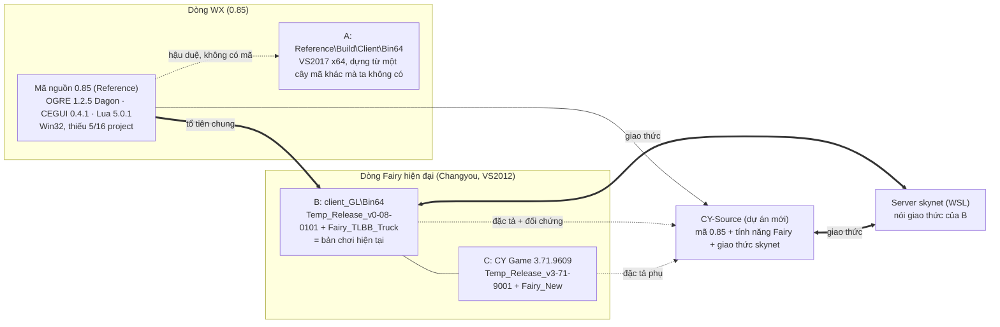

# 02 — Kiến trúc đích và các quyết định kỹ thuật

Ngày lập: 2026-09-12. Căn cứ: khảo sát trong tài liệu `01-HIEN-TRANG-VA-NGUON-LUC_vi.md`. Mọi con số dưới đây đã đo trên file thật; chỗ nào là suy luận thì ghi rõ "(suy luận)".

## 0. Một đoạn tóm tắt

CY-Source dựng một client TLBB 64-bit **từ mã nguồn**:

- **Thân mã:** mã 0.85 (dòng engine WX).
- **Mục tiêu tính năng:** nâng thân mã đó lên ngang dòng Fairy hiện đại, tức `client_GL` và CY 3.71. Các binary hiện đại được dùng làm **đặc tả** và **đối chứng**.
- **Giao thức:** nói giao thức của **server skynet đang chạy**.
- **Dữ liệu:** đọc **một kho dữ liệu chuẩn** hợp nhất CY / HJ / GL / 085.

Trong suốt quá trình, `client_GL` vẫn là bản chơi được, đồng thời là "oracle" để so sánh. Dự án không bao giờ có giai đoạn "tối", tức lúc không có gì chạy được.

## 1. Bản đồ các dòng mã

- B và C cùng một dòng: Jaccard export của OgreMain = 1,000; Render.dll import 1.403 và 1.408 hàm OgreMain. Hai bản khác nhau ở bố cục bảng (HJ và CY/JD) và ở bộ gói tin: C có thêm 2.844 lớp trong Game.exe, trong đó 1.330 lớp thuộc namespace `Packets`.
- Mã 0.85 là tổ tiên của B. Hai bên có chung 288 tên lớp gói tin và 43/86 lớp RTTI của Render.dll, nhưng thiếu toàn bộ lớp Fairy mới.

## 2. Ranh giới module (đã đo)

Bảng dưới đếm số hàm import, lấy bằng `llvm-readobj --coff-imports`:

| Module | B (client_GL) import | 0.85 (A) import |
|---|---|---|
| Game.exe | tEngine 125, LuaPlus 58, fmod64 23, WS2_32 35, … — **không import OgreMain** | tEngine 118, LuaPlus 52, PathLib 6, RSSParser 2, fmod 18 — **không import OgreMain** |
| Render.dll | **OgreMain 1.403**, tEngine 31, PathLib 6 | OgreMain 831, tEngine 21, Plugin_Scorpio 3 |
| UI_CEGUI.dll | CEGUIBase 241, LuaPlus 35, OgreMain 20, tEngine 17, CEGUIOgreRenderer 6 | CEGUIBase 199, LuaPlus 35, CEGUIOgreRenderer 28, tEngine 21, OgreMain 17 |
| CEGUIOgreRenderer.dll | OgreMain 94, CEGUIBase 74 | OgreMain 48, CEGUIBase 39 |
| Plugin_ParticleFX2.dll | OgreMain 115 | OgreMain 112 |

Hệ quả:

## 3. Kiến trúc đích

| Lớp | Tên runtime | Mã gốc trong Reference | Việc phải làm |
|---|---|---|---|
| Game | `Game.exe` | `Client\WXClient` | Giao thức skynet; API Lua của B (2.698 hàm host); các hệ thống mới (ngoại trang, tọa kỵ, võ hồn, điêu văn, raid, đấu giá…) |
| Kernel | `tEngine.dll` | `Client\WXEngine` | Giữ nguyên thiết kế tKernel/tNode; dựng dạng DLL như A/B |
| Script | `LuaPlus.dll` | `Client\LuaPlus` (Lua 5.0.1, có `continue`) | Giữ nguyên; dựng từ mã, **không** dùng `LuaPlus.dll` của B (bản bên thứ ba dựng bằng VS2022, có lớp SuperHook) |
| Trình diễn | `Render.dll` | `Client\WXRender` + `Client\WXCore` | Nâng lên đủ tính năng Fairy của B/C (xem 03, pha E2–E3) |
| Ogre | `OgreMain.dll`, `RenderSystem_Direct3D9.dll` (sau thêm D3D11), `Plugin_ParticleFX2.dll`, `Plugin_OctreeSceneManager.dll` | `OGRE` 1.2.5 Dagon, `ParticleFX2` | Dọn sạch cho x64; thêm DDS ATI1/2, INTZ, 5 affector, 3 element, `curve` cho Cylinder emitter |
| UI | `UI_CEGUI.dll`, `CEGUIBase.dll`, `CEGUIFalagard.dll`, `CEGUIOgreRenderer.dll` | `Client\CEGUISystem`, `Client\CEGUI` 0.4.1, `Client\CEGUIFalagardEx` | Giữ CEGUI; thêm widget của B/C khi layout cần; UTF-8 và codepoint gốc; 36 lớp `LUA_CONTROL` như B |
| Âm thanh | `tSoundSystem` | `Client\WXClient\Sound` (FMOD 3.75, x86) | Chuyển sang FMOD Core 2.x x64 (đọc được `.fsb` của B/C). Bản A đã làm đúng việc này với FMOD 2.2.35 |
| Dữ liệu | `Data\*Folder` khi phát triển, `*.axp` khi phát hành | kho chuẩn `Assets\Canonical` | Xem tài liệu 05 |
| Server | skynet (WSL) | — | Giữ vai trò chủ giao thức; thêm đặc tả máy đọc được và bộ kiểm đồng bộ bảng (tài liệu 06) |

Định dạng dữ liệu đích là **định dạng Fairy hiện hành**:

- `.mesh` v1.40 (đọc được v1.10–v1.30), `.skeleton` v1.10 cộng chunk 0x4120.
- Các file gộp `all.obj`, `all.material`, `all.effect`, `all.particle`, `all.skill`.
- `MaterialTemplates.zip` bản SM3 HLSL (114 file).
- Bản đồ: `.Scene`, `.Terrain`, `.Heightmap`, `.GridInfo`, `.path`, `.WCollision`, `.region`, `.hfog`, `.enscene`, `.hdr`, `.newhdrbloom`.
- Giao diện CEGUI 0.4.1 mở rộng; bảng DBC `00CCBBDD` và bảng text theo **bố cục HJ**.

Mọi nguồn họ Ogre (client_GL, DataCY, CYHJ, CY Game, 0.85) đều đã ở đúng các định dạng này. Khác biệt nằm ở tính năng engine và bố cục bảng, không nằm ở định dạng file.

## 4. Các quyết định

Trạng thái: **Đề xuất** = chờ người dùng xác nhận; **Chốt** = đã có quyết định từ trước, phải tôn trọng.

| # | Quyết định | Lý do (bằng chứng) | Hệ quả | Trạng thái |
|---|---|---|---|---|
| D1 | **Chủ giao thức là server skynet đang chạy.** Không dùng giao thức 0.85, không dùng tlbb15. | Server nói giao thức của B: 24/24 ID mẫu lệch so với 0.85; khoảng 200 gói chỉ có ở skynet. tlbb15 là binary đóng, tắt ASLR, chạy bằng hook `LD_PRELOAD`. | Client mới sinh codec từ đặc tả của skynet (tài liệu 06). Server C++ 0.85 chỉ làm hộp cát và tài liệu. | Đề xuất |
| D3 | **Không nâng lên Ogre mới** (1.9, 13, Next) trước khi đạt ngang B. | Định dạng mesh/skeleton/material/effect gắn với Dagon và phần mở rộng Fairy. | Giữ Ogre 1.2.5, chỉ dọn cho x64 và thêm tính năng. Nâng Ogre để dành cho pha "vượt ngang". | Đề xuất |
| D4 | **Toolchain:** VS2022 Build Tools (v143) cho x64 và x86; Windows SDK 10.0.26100 (đã có); D3D9/D3DX9 dùng thư viện x64 có sẵn trong `DirectX9\Lib\x64`; CMake + Ninja làm hệ build duy nhất từ pha E1b. | Máy chưa có MSVC. `.vcxproj` hiện chỉ có Win32 và thiếu 5 project. Mã có 262 `.vcproj` cũ lẫn lộn. | Pha E1a vẫn dùng `.vcxproj` để dựng nhanh bản đối chứng x86. Sau đó chuyển hẳn sang CMake trước khi port x64. | Đề xuất |
| D5 | **Mã hoá:** mã nguồn lưu UTF-8 và biên dịch với `/execution-charset:.936`; chữ hiển thị là UTF-8; tên tài nguyên giữ byte GBK trong dữ liệu; engine đổi tên GBK sang UTF-16 để mở file bằng `CreateFileW`; cửa sổ Unicode; CEGUI nhận codepoint. | Hệ đang chạy UTF-8 từ 24/08 (Chốt). Hiện có 11 bản vá binary chỉ để có UTF-8. Literal GBK trong mã là khoá tài nguyên. | Bỏ được mọi bản vá code page. Bỏ phụ thuộc ACP 1252. Dữ liệu không phải đổi tên file. | Đề xuất (UTF-8: Chốt) |
| D6 | **Âm thanh: FMOD Core 2.x** thay FMOD 3.75. | FMOD 3.x chỉ có x86. B/C dùng `.fsb` (FMOD 1.10). A đã dùng FMOD 2.2.35. | Cần tải FMOD SDK (người dùng tự tải bằng tài khoản fmod.com) và chấp nhận giấy phép phi thương mại. Phương án thay: miniaudio, nhưng khi đó không đọc được `.fsb`. | Đề xuất (Q3) |
| D7 | **UI: giữ CEGUI 0.4.1 bản mở rộng** và reskin theo GL. | Quyết định 04/09 (Chốt). 1.214 layout và 1.201 script đang dùng. | Thêm widget của B/C: MultiColumnListNew/Ex, ActionButtonWindow, ScrollText, CircleProgress… khi layout cần. | Chốt |
| D8 | **Lua: giữ LuaPlus / Lua 5.0.1 có `continue`.** | Script của B viết cho đúng phương ngữ này (`llex.c:51`, `lparser.c:1419`). | Không nâng Lua. Kiểm cú pháp bằng `lua50check.py`. | Đề xuất |
| D9 | **Đóng gói:** khi phát triển dùng thư mục rời, khi phát hành dùng AXP v1.1. Engine đọc được cả hai. Không dùng `ccore.dat`/`ndata.dat` (mã hoá của CY) và không dùng `rail_api` (WeGame). | AXP v1.1 đã có công cụ đọc/ghi (`Tools\AXPDecryptor`). | Viết `Tools\pipeline\package_axp.py`. | Đề xuất |
| D10 | **Renderer:** giai đoạn 1 dùng D3D9 (Ex) x64 với SM3, để chạy nguyên 114 template HLSL. Giai đoạn 2 viết `RenderSystem_Direct3D11` cho Dagon. | Cả A/B/C lúc chạy đều dùng D3D9 SM3; không bản nào có bộ material SM4/5. | D3D11 thuộc pha "vượt ngang" (V1). | Đề xuất |
| D11 | **Lớp game:** tiến hoá WXClient sang giao thức skynet, cộng thêm API Lua theo tần suất gọi. B là sản phẩm cho tới khi đạt cổng M5. | 513/2.698 hàm host đã có. Nhóm thiếu nhiều hàm nhất: DataPool 489 hàm, Pet 276, Exterior 156, Player 106 (`Docs\evidence\lua_api_gap.json`, danh sách theo lượt gọi ở `lua_api_gap_methods.tsv`). | Chạy nguyên 1.201 script UI và bản reskin GL của `client_GL`, không viết lại UI. | Đề xuất |
| D12 | **Không dùng** các binary của nền tảng CY hoặc bên thứ ba khi không có mã: `LuaPlus.dll` của B, `rail_api.dll`, `ccore.dat`, tlbb15. | Không kiểm soát được; có dấu hiệu hook. | Mọi DLL trong `Build\Client\Bin64` phải dựng từ `Src`, trừ runtime của hãng (VC++, D3DX, FMOD, Cg). | Đề xuất |
| D13 | **Server C++ 0.85** (`Reference\Build\Server` x64 + MariaDB) dùng làm **hộp cát** cho pha E1: client tự dựng đi lại được trong thế giới 0.85 mà không phụ thuộc giao thức mới. Nó cũng là tài liệu công thức và cấu trúc gói. | Có sẵn bản build x64 và gói môi trường MariaDB (`环境_v0-85-9602_Win`). | Không đưa server C++ vào sản phẩm. | Đề xuất |
| D14 | **SceneEdit (FairyEditor)** chỉ dựng bản x86 và để sau. Công việc bản đồ tiếp tục bằng `Tools\map-convert` (Python). | wxWidgets 2.6.1 chỉ có lib x86, không có mã; phụ thuộc FMOD 3.74 x86. | Pha tuỳ chọn E6. | Đề xuất |
| D15 | **Chỉ sửa trong `CY-Source`** (và `client_GL` khi cài nội dung cho bản chơi hiện tại). `Reference` chỉ đọc. `client` gốc chỉ đọc. | Quy tắc 06/09 (Chốt). | Mọi bản sao từ `Reference` sang `Src` đều ghi manifest hash. | Chốt |

## 5. Phương án đã cân nhắc và loại

| Phương án | Vì sao loại |
|---|---|
| Dựng mã 0.85 rồi chạy ngay với server skynet | Giao thức khác: đánh số, bố cục trường, header, phiên bản đăng nhập (0x705 → 0x785). Client 0.85 cũng chỉ có 19 % API Lua mà UI hiện tại cần. |
| Viết engine mới hoàn toàn (kiểu "GL REAL A") | Đã loại ngày 06/09/2026: 60–120 người-tháng và mâu thuẫn thế giới/giao thức (`GL REAL\01`). |
| Lấy CY 3.71 (C) làm sản phẩm | C gắn với bảng CY/JD (103/73/54 cột) và bộ gói tin của nó. Muốn dùng phải viết lại server. |
| Ghép module tự dựng vào dưới Game.exe của B | Giao diện truyền `std::string`/`std::list`, nên chỉ khả thi nếu dựng bằng VS2012 (v110). Để lại làm thí nghiệm tuỳ chọn H0 (tài liệu 04 mục 10), không phải đường chính. |
| Nâng lên Ogre hiện đại ngay | Mất tương thích định dạng Fairy; khối lượng chuyển đổi dữ liệu rất lớn. |
| Dùng tlbb15 | Binary đóng; muốn mở rộng giao thức chỉ có cách vá thêm. |

## 6. Câu hỏi mở cho người dùng

| # | Câu hỏi | Ảnh hưởng |
|---|---|---|
| Q1 | Bạn có cây mã `Temp_Release_v0-85-9602\Prj\GameCode` (bản đã port x64, có D3D11, PathLib, FMOD 2.2 — nguồn gốc của `Reference\Build\Client\Bin64`) không? | Nếu có, bỏ qua gần hết pha E1 và phần PathLib. |
| Q2 | Xác nhận mục tiêu cuối: chơi trên server skynet hiện tại (thế giới 085 cộng nội dung CY/HJ/GL đã nhập). | Quyết định D1 và D11. |
| Q3 | Chấp nhận giấy phép FMOD Core (miễn phí cho dự án phi thương mại), hay muốn thư viện mở (miniaudio / OpenAL Soft) và bỏ `.fsb`? | D6 |
| Q4 | Cho phép khởi tạo git cục bộ trong `CY-Source` không? File `.gitignore` đã chuẩn bị sẵn, loại trừ `Reference`, `Assets`, `Build`. | Quản lý thay đổi từ pha E0 |
| Q5 | Cho phép cài VS2022 Build Tools, CMake và Ninja bằng winget không? | Điều kiện của pha E0 |

**Người dùng trả lời ngày 12/09/2026:**
- Q1: không có thêm mã hay tài liệu nào, nên pha E1 làm đầy đủ từ mã 0.85.
- Q2–Q5: cho phép tất cả.
- **Ưu tiên số một: ĐẸP (hình ảnh).**

**Hệ quả:**
- Đường ray E (E2/E3: model, effect, particle, texture, hậu kỳ, bóng) và đường ray D đi trước. Đường ray G (giao thức, lối chơi) làm sau.
- VS 2022 Build Tools 17.14 (MSVC 14.44, kèm CMake + Ninja) đã có sẵn trên máy. Lần kiểm đầu không thấy vì `vswhere` cần cờ `-products *`.
- Đã `git init` và nhập mã.
- FMOD Core phải tải bằng tài khoản fmod.com, nên người dùng sẽ tự tải khi tới phần âm thanh.
