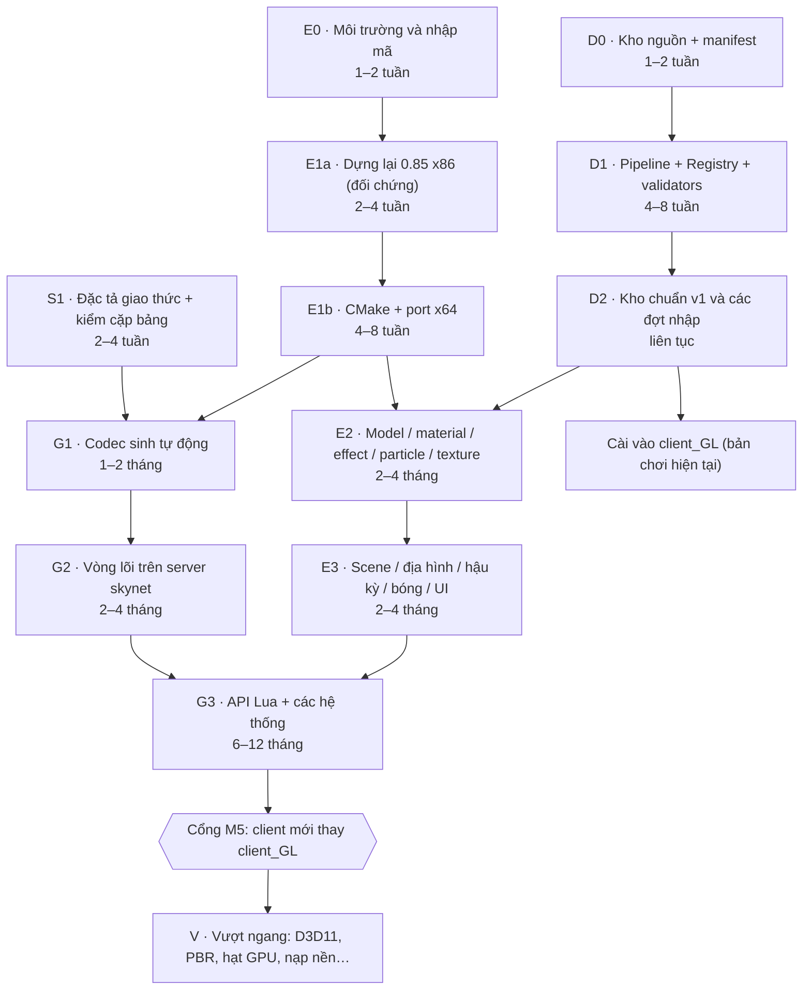

# 03 — Lộ trình tổng thể: các pha, cổng nghiệm thu, ước lượng

Ngày lập: 2026-09-12. Cần đọc trước tài liệu `02-KIEN-TRUC-VA-QUYET-DINH_vi.md`.

## 0. Cách đọc lộ trình

Lộ trình gồm năm đường ray song song:

| Ký hiệu | Đường ray | Sản phẩm |
|---|---|---|
| **D** | Dữ liệu và tài sản | Kho chuẩn hợp nhất CY/HJ/GL/085 + sổ ID + bộ kiểm. **Phục vụ `client_GL` ngay từ tuần đầu.** |
| **E** | Engine từ mã nguồn | Client x64 dựng từ `Src`, rồi nâng lên đủ tính năng Fairy (model, material, effect, particle, texture, scene, hậu kỳ) |
| **G** | Lớp game và giao thức | Client nói giao thức skynet và chạy nguyên UI của `client_GL` |
| **S** | Server hỗ trợ | Đặc tả giao thức máy đọc được; kiểm cặp bảng client–server |
| **Q** | Kiểm thử và phát hành | Bộ đối chứng, validator, bot, cổng nghiệm thu (tài liệu 07) |

Mỗi pha ghi đủ: mục tiêu, việc chính, sản phẩm, **cổng** (điều kiện đo được để qua pha), ước lượng và rủi ro.

**Về ước lượng:** tính cho một lập trình viên chính làm toàn thời gian, có trợ lý AI đi kèm. Đó là khoảng dự đoán, không phải cam kết; mỗi lần qua cổng phải đo lại.

## 1. Sơ đồ phụ thuộc

## 2. Cột mốc

| Mốc | Người dùng thấy được gì | Ước lượng tích luỹ |
|---|---|---|
| **M0** | Máy dựng được mã; có git; manifest nguồn; CodeGraph lập chỉ mục `Src` | ~2 tuần |
| **D-1** | Đợt nhập đầu tiên đi qua pipeline mới, cài vào `client_GL` và được xác nhận trong game | 4–8 tuần (song song với E) |
| **M1** | Game.exe x64 dựng từ `Src` đi lại được trong thế giới 0.85 (hộp cát: server C++ 0.85 + MariaDB) | 2–3 tháng |
| **M2** | "TLBB Viewer" x64 dựng từ `Src` hiển thị model, effect, particle, texture 2026 của CY/HJ giống `client_GL` | 4–6 tháng |
| **M3** | Viewer hiển thị cảnh (địa hình, nước, sương, HDR, bóng, hậu kỳ) giống `client_GL` | 6–9 tháng |
| **M4** | Client mới vào được server skynet: đăng nhập, tạo/chọn nhân vật, vào cảnh, đi, đánh quái, chat, với UI của `client_GL` | 8–12 tháng |
| **M5** | Ngang `client_GL` ở các hệ thống lõi; người dùng chơi hằng ngày bằng client mới | 15–24 tháng |
| **M6+** | Vượt ngang: D3D11, PBR đầy đủ… | sau M5 |

Nếu có cây mã `Temp_Release_v0-85-9602\Prj\GameCode` (câu hỏi Q1 trong tài liệu 02), M1 rút xuống khoảng 1 tháng.

## 3. Đường ray D — Dữ liệu và tài sản (bắt đầu ngay)

### D0 — Kho nguồn và manifest (1–2 tuần)
- **Việc chính:**
  - Lập `Assets\Sources\sources.yaml` mô tả 7 nguồn S1–S7 (đường dẫn, phiên bản, vai trò, quyền chỉ đọc; tài liệu 05 mục 2).
  - Bổ sung SHA-256 vào manifest đã có ở `Assets\Sources\manifests-2026-09-12\`.
  - Lập chỉ mục model của từng nguồn theo tên mesh/obj.
  - Ghi nhận 7.368 mục AXP kiểu 1–18 của CY Game (sẽ lấy bản đã giải trong DataCY).
- **Sản phẩm:** manifest + chỉ mục; báo cáo khớp DataCY ↔ CY Game, lấy kích thước chuẩn = kích thước trong `(list)` − 96.
- **Cổng D0:** đủ manifest cho 7 nguồn; không còn file nào của S1–S4 mà pipeline không đọc được, trừ `.xzip` là bản vá đã được áp sẵn vào `.axp`.

### D1 — Pipeline chuẩn hoá, Registry, validators (4–8 tuần)
- **Việc chính:**
  - `Tools\pipeline\ingest.py`: đọc thư mục rời, AXP, JPAK; cắt đệm 0; chuẩn hoá tên.
  - `registry.py`: dải ID và kiểm va chạm với cả client lẫn server.
  - `tables.py`: ánh xạ cột CY/JD → HJ; ghi bảng client UTF-8 và bảng server GBK.
  - `merge.py`: chọn bản chuẩn theo luật.
  - `install.py`: cài vào `client_GL` và server, có check/apply/verify/revert.
  - Gộp các bộ kiểm của `analysis\full-audit-2026-09-10` và `Tools\rasoat-4phai` thành `Tests\validators`.
- **Cổng D1:** chạy lại bằng pipeline một đợt nhập trước đây làm tay (6 tọa kỵ 2026 hoặc 楚小九). Kết quả phải trùng trạng thái hiện tại của `client_GL` (khác biệt duy nhất được phép là ID), và validators báo 0 lỗi.

### D2 — Kho chuẩn v1 và các đợt nhập (liên tục)
- **Việc chính:**
  - Sinh `Assets\Canonical` = S1 (`client_GL`) cộng các gói nhập CY/HJ theo danh sách ưu tiên của người dùng; tài sản GL đi qua bộ chuyển đổi.
  - Mỗi đợt nhập có một **"bảng chọn bản"**: ảnh render các phiên bản của cùng một món đặt cạnh nhau, để người dùng chọn (tài liệu 05 mục 3.3).
- **Cổng D2 (mỗi đợt):** validators 0 lỗi; cài xong vào `client_GL` và server; người dùng xác nhận trong game.

### D3 — Tuỳ chọn: bẻ các định dạng GL còn thiếu
Phạm vi:
- `.pu` (JBPU, 8.015 file) → `all.effect` / `all.particle`.
- Lớp texture trong `.Block` và `.walkplane` → `.path`.
- Lightmap ALI8.

Cổng: một hiệu ứng pet GL và một map GL nhỏ hiển thị đúng trong `client_GL`.

## 4. Đường ray E — Engine từ mã nguồn

### E0 — Môi trường và nhập mã (1–2 tuần)
- **Việc chính** (chi tiết ở tài liệu 04, mục 2–3):
  - Cài VS2022 Build Tools, CMake, Ninja; tải FMOD Core và Cg Toolkit 3.1 (có lib x64).
  - `git init`, nếu người dùng đồng ý (Q4).
  - Nhập mã từ `Reference` vào `Src`, chuyển sang UTF-8, ghi manifest, commit "nguyên trạng".
  - Thêm `Src` vào CodeGraph.
  - Chụp baseline của `client_GL` cho bộ đối chứng.
- **Cổng E0:**
  - `vswhere` thấy MSVC v143 x86/x64.
  - Commit đầu chứa mã nguyên trạng, kèm manifest hash của từng file.
  - CodeGraph trả được callers/callees cho `CGameProcedure`.

### E1a — Dựng lại 0.85 x86 làm đối chứng (2–4 tuần)
- **Việc chính:**
  - Tạo lại 5 project bị thiếu (OgreMain, TinyXML, FreeType, Expat, Opcode).
  - Dựng theo thứ tự phụ thuộc (tài liệu 04, mục 4.1).
  - Đặt tên file chạy theo bố cục của game: `Game.exe`, `Render.dll`, `UI_CEGUI.dll`…
  - Chạy với `Reference\…\Build\Client\Data` và hộp cát server 0.85.
  - Đo `sizeof`/`offsetof` của mọi struct dùng trong gói tin và file, ghi vào `Registry\abi\struct_sizes_x86.json`.
- **Cổng E1a:** client x86 tự dựng vào được thế giới 0.85, đi lại và đánh quái 30 phút không crash; log không có lỗi mới so với bản `Reference\…\Build\Client\Bin` chạy cùng cảnh.

### E1b — Chuyển sang CMake và port x64 (4–8 tuần)
- **Việc chính:**
  - Toàn bộ mã sang CMake, có preset x86 và x64.
  - Sửa theo danh mục port x64 (tài liệu 04, mục 5).
  - Thay phụ thuộc chỉ có bản x86: DevIL, freetype, zziplib, expat, Xerces, FMOD 3.x → FMOD Core 2.x.
  - Thêm `static_assert` kích thước cho các struct gói tin và file.
- **Cổng E1b (= M1):**
  - Game.exe x64 dựng từ `Src` qua được mọi mục của cổng E1a.
  - 0 cảnh báo C4311/C4312/C4302 trong mã game.
  - Ảnh cùng cảnh khớp nội dung với bản A (`Reference\…\Build\Client\Bin64`).

### E2 — Tính năng Fairy: model, material, effect, particle, texture (2–4 tháng)
Pha này đi thẳng vào trọng tâm người dùng yêu cầu. Việc chính, theo thứ tự làm:

1. **Hệ tài nguyên:**
   - Thêm các khe Model4–8, Material6–8, Scene2.
   - Hỗ trợ các file gộp `all.obj`/`all.material`/`all.effect`/`all.particle`/`all.skill`.
   - Đọc AXP v1.1.
   - Đổi tên GBK sang UTF-16 khi mở file.
2. **Hệ material:**
   - Nạp 114 template HLSL SM3 của B/C làm dữ liệu.
   - Hiện thực cơ chế auto-param (`ShaderLib\ParamNamedAuto.inc`, `MAX_SKIN_BONE_NUM` 74) và hardware skinning.
   - Hỗ trợ các khe texture mới: `envTexture`, `MaskTexture`, `DTexture0–2`, `DNTexture0–2`.
3. **LogicModel:**
   - Đủ 20 phần tử và 27 thuộc tính của `all.obj` như B.
   - Hỗ trợ `.dynbone` (XML `EntityDynamicBones`), `.model` và `.frame`.
4. **Effect / particle:**
   - 9 kiểu effect/skill mà mã 0.85 chưa có: NewRibbonTrail, UIParticle, RevoluMove, SequenceFrame, Dissolve, RotationCurve, PolarMove, CameraShake, ComplexBlur. DataCY dùng chúng 5.653 lần.
   - Thêm tham số `dissolveBox` và `curve` cho Cylinder emitter.
5. **Texture và mesh:** DDS ATI1/ATI2/RXGB; mesh index 32-bit (3–7 % mẫu mesh CY/HJ dùng loại này).

Kèm theo là công cụ **TLBB Viewer**: một exe nhỏ dùng Render.dll của ta, không cần server, mở model hay effect theo tên. Viewer là nền của bộ đối chứng ảnh.

- **Cổng E2 (= M2):**
  - Bộ đối chứng gồm ≥ 50 model 2026 của CY/HJ (người, pet, tọa kỵ, vũ khí, thời trang) và ≥ 100 effect.
  - Ảnh chụp từ Viewer phải gần như trùng ảnh `client_GL` (SSIM ≥ 0,95 trên vùng có model).
  - Log không có dòng "unknown element/affector/template".

### E3 — Tính năng Fairy: scene, địa hình, hậu kỳ, bóng, UI (2–4 tháng)
- **Việc chính:**
  - Các file cảnh: `.region`, `.hfog`, `.enscene`, `.skysphere`/EnvKey, `.hdr`/`.newhdrbloom`, `.godrays`.
  - Khung RenderNode và 29 PostFilter. Ưu tiên: FXAA, NewHDRBloom, Floodlighting, ColorLUT, GenSSAO, DoF, GodRays, HeightFog. Đặc tả chi tiết và thứ tự làm theo mức đẹp: `Docs\specs\render\00-INDEX.md`.
  - Shadow map + CSM + PCF, cỡ map đặt được bằng cấu hình.
  - Độ sâu INTZ; nạp tài nguyên nền.
  - Widget CEGUI của B/C.
  - PathLib viết mới.
  - **Mọi hiệu ứng bật theo cấu hình ngay lúc khởi động**, bỏ hẳn hook Lua.
- **Cổng E3 (= M3):**
  - Bộ đối chứng ≥ 10 cảnh (Tô Châu, Lạc Dương, Đại Lý, Summoner's Rift, cảnh chọn nhân vật GL, một cảnh chỉ CY có…) gần như trùng `client_GL`.
  - FXAA, HDR và bóng bật từ cfg.
  - Mục tiêu 60 fps ở 1440p trên RTX 2060 tại Tô Châu.

### E4 — Tuỳ chọn: công cụ biên tập
Hai hướng: dựng SceneEdit/FairyEditor bản x86 (cần mã wxWidgets 2.6.1), hoặc làm editor mới trên engine x64. Làm sau E3.

## 5. Đường ray G — Lớp game và giao thức

### G1 — Đặc tả và codec (1–2 tháng; phần đặc tả có thể làm từ E0)
- **Việc chính:**
  - `Tools\protocol\specgen.py` sinh `Registry\protocol\packets.yaml` cho 482 + 16 ID: trường, kiểu, độ dài, giới hạn.
  - Đặt tên các trường `unknow_N` dựa trên 288 lớp gói chung với C++ 0.85 và trên Ghidra của B.
  - Sinh codec C++ vào `Src\Client\WXNetPackets\gen\` và codec Python cho `tlbb_sim`.
- **Cổng G1:** 100 % gói trong đặc tả có codec C++ và Python; khứ hồi đúng từng byte trên bộ gói bắt được từ ≥ 1 phiên chơi đầy đủ của `client_GL`.

### G2 — Vòng lõi (2–4 tháng)
- **Việc chính:**
  - Đăng nhập (`CGLoginAcc`, phiên bản 0x785); danh sách, tạo và xoá nhân vật.
  - Vào cảnh và đổi cảnh (một lần đăng nhập lại thu nhỏ).
  - Di chuyển theo path; đối tượng xuất hiện và biến mất; chiến đấu cơ bản; chat; túi đồ.
  - Nạp layout/script của `client_GL`: gắn 513 hàm API đã có, rồi bổ sung các hàm vòng lõi cần.
- **Cổng G2 (= M4):** trên server skynet: đăng nhập → vào thế giới → đi 10 phút → đánh quái → nhặt đồ → chat, không crash; bộ đếm "gọi hàm Lua không tồn tại" = 0 với các cửa sổ lõi (tài liệu 07, mục 3.4).

### G3 — API Lua và các hệ thống (6–12 tháng)
- **Việc chính:**
  - Bổ sung 2.185 hàm host còn thiếu, theo nhóm và theo tần suất gọi: DataPool, Pet, Exterior, Player, LifeAbility, PlayerPackage, Guild, PlayerShop, SystemSetup, City, ItemBar, GuildLeague… (`Docs\evidence\lua_api_gap.json`).
  - Xử lý 274 mã lệnh `GCUICommand`.
  - Các hệ thống mới: ngoại trang, tọa kỵ, võ hồn, điêu văn, raid, đấu giá, trang sức…
- **Cổng G3 = M5:** danh sách kiểm chức năng (tài liệu 07, mục 3.5) đạt 100 % mục bắt buộc; người dùng chơi 7 ngày bằng client mới không gặp lỗi chặn.

## 6. Đường ray S — Server hỗ trợ
- **S1 (2–4 tuần, song song với D1/G1):**
  - Sinh đặc tả giao thức.
  - Viết bộ kiểm cặp bảng client–server (ID và cột).
  - Cắt chuỗi UTF-8 an toàn cho mọi trường độ dài cố định.
  - Ghi dải ID vào Registry (tài liệu 06).
- **S2 (liên tục):** khi client mới nới giới hạn hoặc thêm hệ thống, cập nhật server tương ứng; restart theo đúng quy tắc (tài liệu 08, mục 8.1).

## 7. V — Vượt ngang (sau M5; hạng mục độc lập có thể làm sớm hơn)

| # | Hạng mục | Điều kiện |
|---|---|---|
| V1 | `RenderSystem_Direct3D11` (SM5) cho Dagon; bộ material SM5 tương ứng | Qua E3 |
| V2 | PBR đầy đủ (template `Model_Pbr_*` đã có sẵn) + IBL | V1 hoặc D3D9 |
| V3 | Hệ hạt GPU; hiệu ứng mới | E2 |
| V4 | Nạp nền đa luồng; LOD và giới hạn model theo AOI | E3 |
| V5 | UI co giãn theo DPI (khi đã sở hữu CEGUI) | G3 |
| V6 | Nâng giới hạn 74 xương/submesh (shader mới) | E2 |
| V7 | Texture BC7 (dữ liệu hiện chỉ có DXT1/3/5) | V1 |

## 8. Đường găng và cách chạy song song
- **Đường găng tới M5:** E0 → E1a → E1b → G1 → G2 → G3. E2/E3 phải xong trước khi G3 kết thúc, vì thế giới và UI cần đủ tính năng render.
- **D chạy độc lập từ ngày đầu.** Mọi thứ D làm ra đều dùng ngay cho `client_GL`.
- **Chia gói việc nhỏ.** E2 và G3 tách được thành các gói nhỏ độc lập, ví dụ một kiểu effect hay một nhóm API. Mỗi gói có đặc tả và test riêng, nên giao song song cho nhiều agent được. Cổng của gói: test của nó qua và bộ đối chứng không lùi.

## 9. Rủi ro chính

| Rủi ro | Mức | Giảm thiểu |
|---|---|---|
| G3 (2.185 hàm + hệ thống mới) lớn hơn ước lượng | Cao | Ưu tiên theo tần suất gọi và theo chức năng người dùng thật sự dùng; tự động hoá việc lấy đặc tả từ Ghidra; đo tiến độ bằng số hàm và số cửa sổ chạy được |
| Hình ảnh khác B ở chi tiết nhỏ (thứ tự render, auto-param) | Trung bình | Bộ đối chứng ảnh + so log; dùng nguyên 114 template làm dữ liệu |
| PathLib và D3D11 không có mã | Trung bình | PathLib viết lại theo đặc tả `.path` + `pathlib-out\all.c`; D3D11 để sang pha V |
| Server đổi giao thức trong lúc làm | Thấp–TB | Đặc tả sinh tự động từ server; chạy lại test khứ hồi mỗi khi server đổi |
| Kích thước struct lệch khi chuyển x86 → x64 | Trung bình | `static_assert` theo số đo ở E1a; `time_t` đổi sang kiểu cố định |
| Chạy client làm đá phiên của người dùng | — | Quy tắc vận hành (tài liệu 08, mục 8.3) |
| Q1 có câu trả lời "có" | Cơ hội | E1 rút còn 1–2 tuần |
