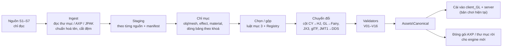

# 05 — Quy trình tài sản: hợp nhất CY / HJ / GL / 085

Ngày lập: 2026-09-12. Áp dụng cho đường ray D (pha D0–D3), tức mọi lần nhập model, effect, particle, texture, bản đồ, UI, bảng hay âm thanh. Số liệu lấy từ đợt kiểm kê ngày 12/09; bằng chứng nằm ở `Docs\evidence\assetinv\` (mở `fullscan.json` và `fxkeys.json` trước).

## 0. Mục tiêu

Có một kho dữ liệu chuẩn `Assets\Canonical` với các tính chất sau:
- Sinh lại được bằng một lệnh, từ các nguồn chỉ đọc.
- Mọi ID nằm trong sổ ID (`Registry`), mọi file đã qua bộ kiểm (`Tests\validators`).
- Cài được ngay vào `client_GL` (bản chơi hiện tại) và dùng làm dữ liệu cho engine mới.

Trọng tâm là **model, effect, particle và texture**.

## 1. Nguyên tắc

1. **Nguồn chỉ đọc.** Không sửa gì trong `Tools\DATA NEW`, `client`, `Reference`.
2. **Không so theo ID giữa các nhánh.** So theo tên obj/mesh, kèm hash nội dung. Mọi món nhập vào đều được cấp ID mới qua Registry.
3. **Mỗi tài sản có hồ sơ gốc:** nguồn, đường dẫn gốc, hash gốc, các phép biến đổi đã áp, người duyệt và ngày duyệt.
4. **File GBK sửa ở mức byte.** Gồm `all.*` và tên nội bộ trong model. Tên file giữ byte GBK.
5. **Bảng theo bố cục HJ**, vì server và `client_GL` đều dùng bố cục này. Dữ liệu CY/JD phải đi qua ánh xạ cột (tài liệu 08, mục 7.3).
6. **Không xoá.** Muốn bỏ thì cách ly và ghi manifest.
7. **Mọi bước ghi** có đủ check/apply/verify/revert và sao lưu trước khi ghi.

## 2. Nguồn và vai trò

| Mã | Nguồn | Nhận dạng | Quy mô | Vai trò |
|---|---|---|---|---|
| S1 | `C:\TLBB\085\client_GL\Data` | Client đang chơi: bảng bố cục HJ, đã UTF-8, chứa các đợt nhập 2026 | 81.114 file / 15,95 GB; 431 bảng (378 DBC nhị phân, 53 text) | **Gốc** của kho chuẩn |
| S2 | `Tools\DATA NEW\DataCY31-08-26` | Dữ liệu client nhánh CY/JD 3.71, giải ra khoảng 2 tuần trước S4 (bộ giải có chèn đệm 0 ở cuối file) | 108.847 file / 21,44 GB; 739 bảng text GBK | Nguồn model/texture/effect CY. **Chỉ S2 có bản đã giải của 7.368 mục model mà AXP S4 bọc kiểu 1–18** |
| S2b | `…\DataCY31-08-26\tlbb15` | Server Linux x64 C++ bị hook, bố cục bảng HJ | 10.251 file | Chỉ để tham khảo; không dùng |
| S3 | `Tools\DATA NEW\CYHJ091026` | Bản chính thức 怀旧 (HJ), 2026-09/10; bố cục cột trùng S1 | 75.536 file / 13,48 GB; 446 bảng text GBK | Nguồn nội dung HJ; biến thể `dweapon_hj2026*` |
| S4 | `Tools\DATA NEW\CY Game\Data` | 《新天龙八部》永恒经典版 3.71.9509, đã vá lên 3.71.9609 | 23 file `.axp` (AXP v1.1), 108.726 mục / 21,67 GB; 742 bảng DBC | Bản chuẩn về **độ dài** file của S2; nguồn cho các mục không bọc hoặc bọc kiểu 19–25 |
| S5 | `Tools\DATA NEW\TLGL_extracted` | Client 天龙八部·归来 1.0.190, engine khác (D3D11) | 120.934 file / 10,02 GB | Ảnh UI (PNG), model qua bộ chuyển. **Không** dùng được layout, Lua hay map |
| S6 | `DIY`, `TTrangNew`, `trâu`, bộ cài XTLBB (rar) | Công cụ giải GL; gói thời trang 七夕项羽/七夕虞姬/聂风/第二梦; model JX3 辛丑牛02; bộ cài của S4 | — | Gói lẻ |
| S7 | `CY-Source\Reference\…\Build\Client\Data` | Dữ liệu 0.85 gốc | 22.791 file / 1,40 GB | Chỉ dùng cho hộp cát 0.85. Material của nó cần 12 template cũ, **không trộn** vào kho chuẩn |

**Định dạng giống nhau ở mọi nguồn họ Ogre** (S1, S2, S3, S4, S7, TTrangNew):

| | S1 | S2 | S3 | S4 | S7 |
|---|---|---|---|---|---|
| Mesh v1.40 / v1.30 | 21.179 / 1.993 | 33.157 / 1.476 | 19.530 / 1.993 | 27.197 / 1.334 (+ 6.101 không giải được) | 6.452 / 0 |
| Skeleton `[Serializer_v1.10]` | 100 % | 100 % | 100 % | 7.194 (+ 1.267 không giải được) | 100 % |
| Có chunk 0x4120 (mẫu 300 skeleton có animation) | 94,3 % | 94,0 % | 96,3 % | 95,9 % | 97,3 % |
| Mesh dùng index 32 bit (mẫu 300) | 4,3 % | 4,7 % | 3,3 % | 6,7 % | 0 |
| Số xương lớn nhất trong mẫu | 115 | 181 | 195 | 238 | 127 |
| DDS DXT1 / DXT3 / DXT5 | 20.715 / 15.115 / 20 | 26.855 / 20.704 / 22 | 19.729 / 13.651 / 14 | 26.854 / 20.705 / 22 | 5.727 / 2.988 / 0 |
| DDS ≥ 2048 px | 115 | 159 | 74 | 159 | 0 |

Không nguồn nào có BC5, BC7 hay DDS header DX10. Chỗ khác nhau giữa các nguồn nằm ở tính năng engine và bố cục bảng, không nằm ở định dạng file.

### 3.1 Nguồn chính theo loại tài sản

| Loại | Nguồn chính | Nguồn phụ | Lý do |
|---|---|---|---|
| Nội dung gốc và nội dung tự làm | S1 | — | Đã UTF-8, đã có các đợt nhập 2026 |
| Model + texture nhánh CY | File lấy từ S2, **độ dài theo S4** | S4 cho mục không bọc / bọc kiểu 19–25 | Chỉ S2 có bản giải của các mục kiểu 1–18; payload của S4 mới có độ dài chính xác |
| Model + texture nhánh HJ | S3 | — | Cùng bố cục với S1; có biến thể chính thức `hj2026` |
| Effect / particle / skill | S2 (≈ S4: 19.029 effect / 59.786 particle / 5.828 skill) | S3 cho phần chỉ HJ có (238 effect, 1.247 particle, 57 skill, 1.784 material) | Không có từ khoá mới; nhập theo tên |
| Material | `all.material` của S1, cộng các mục lấy theo tên từ S2/S3 | Zip template của S2/S4 (phải thử trước) | Mọi template cha đã có trong S1 |
| Bảng | Dòng của S3 | S2/S4 chỉ qua ánh xạ cột | Bố cục khớp S1 và server |
| Bản đồ | S3 (HJ); S2 cho map chỉ CY có (汴京, `*_ZM`…) | — | Cần `.region`, `.hfog`, HDR (B hỗ trợ) cộng dữ liệu scene phía server |
| UI | S1 | Cửa sổ của S3; ảnh PNG của S5 | S2/S4 gộp imageset vào một file `Schema\all.imageset.xml` |
| Âm thanh | S2/S4 | S3 | Bộ lớn nhất, không mã hoá |

### 3.2 Khi một món có nhiều bản

Ví dụ: 3 huyễn sức DataCY so với bản `dweapon_hj2026*` của CYHJ, hay 楚小九 bản CY so với bản HJ. Xếp hạng theo thứ tự:

1. **Đầy đủ:** có đủ mesh, skeleton, bộ animation chuẩn, effect, texture; không thiếu file nào trong chuỗi phụ thuộc.
2. **Chất lượng:** số đỉnh, độ phân giải texture, số cấp hay biến thể.
3. **Tương thích:** hợp bố cục bảng HJ và không đòi hệ thống server mới. Ví dụ Type 27 của thời trang HJ chưa rõ `client_GL` có hỗ trợ không.
4. **Mới:** bản chính thức gần nhất (năm thường ghi trong tên file, như `2026七夕`, `250415`).
5. **Người dùng quyết** qua bảng chọn bản.

### 3.3 Bảng chọn bản (render sheet)

- `Tools\pipeline\review.py` sinh `Assets\Staging\review\<đợt>\index.html`, là file cục bộ, không đăng lên đâu cả.
- Mỗi món có ảnh render các bản đặt cạnh nhau, dựng bằng Blender qua `tlbb2gltf.py`; từ M2 thì dựng bằng TLBB Viewer. Kèm thông số: đỉnh, xương, số texture và độ phân giải, danh sách animation, effect.
- Người dùng chọn xong thì ghi vào `Registry\selections\<đợt>.yaml`. `merge.py` chỉ nhập các món đã có lựa chọn.

## 4. Sổ ID (Registry)

- `Registry\ids\<bảng>.tsv` gồm các cột: `id`, `khoá` (tên obj/mesh/item), `nguồn`, `đợt`, `trạng thái` (reserved/active/retired), `ghi chú`.
- `Registry\id-ranges.yaml` chia dải ID cho từng nhóm (CY, HJ, GL, tự làm). Dải cụ thể chốt ở pha D1, **sau khi** quét ID còn trống ở cả client lẫn server. Lý do: server hiện có sẵn 948 dòng EquipBase, 1.268 SkillData_V1, 310 MonsterAttrEx và 202 PetAttr mà client không có.
- **Luật:**
  - ID mới phải trống ở cả client lẫn server, trên mọi Type.
  - Item ID có dạng `10 Q TT NNN`; server suy Type bằng `floor(id % 100000 / 1000)`.
  - Bảng phía client sắp ID tăng dần.
- `registry.py check` chạy ở đầu và cuối mọi đợt nhập.

## 5. Đường ống

| Khâu | Vào | Ra | Công cụ |
|---|---|---|---|
| Ingest | S1–S7 | `Assets\Staging\<S>\` cộng `manifest.tsv` (đường dẫn, kích thước, SHA-256, nguồn, kiểu bọc AXP) | `ingest.py`, dựa trên `axp_index.py`, `AxpDecryptor`, DIY |
| Chuẩn hoá | Staging | Tên thống nhất (byte GBK); cắt đệm 0 ở cuối file của S2/S3 theo kích thước `(list)` − 96 của S4; kiểm parse mesh/skeleton | `ingest.py` |
| Chỉ mục | Staging | `index\models.tsv` (obj → mesh, skeleton, material, texture, effect), `effects.tsv`, `materials.tsv`, `rows\<bảng>.tsv` | `index_models.py`, `fxkeys.py` |
| Chọn / gộp | chỉ mục + lựa chọn + Registry | `plan\<đợt>.yaml`: danh sách file cần chép, dòng cần thêm, ID mới, xung đột tên | `merge.py`, `registry.py` |
| Chuyển đổi | plan | file đã chuyển | `tables.py`, `glpet2tlbb.py`, `gltf2tlbb.py`, `jx3mount2tlbb.py`, `jmt2png.py` + texconv |
| Kiểm | kết quả | báo cáo `Build\Logs\<đợt>\validate.html` | `Tests\validators` (mục 7) |
| Kho chuẩn | đã kiểm | `Assets\Canonical\Data\*Folder`; các file `all.*` được **dựng lại có thứ tự, xác định** (cùng đầu vào thì cùng byte) | `merge.py` |
| Cài / đóng gói | kho chuẩn | `client_GL\Data` + bảng server (GBK), hoặc `Build\Packs\*.axp` | `install.py`, `package_axp.py` |

### 6.1 Model (người, NPC, quái, trân thú, tọa kỵ, vũ khí, thời trang)

1. **Xác định object** trong `all.obj` và các thành phần của nó:
   - entity (mesh);
   - material: trong `all.material`, hoặc bên trong `.mesh` khi `material=""`;
   - skeleton (`skeletonLink`) và tên animation, đối chiếu với `ActionSetKV`;
   - locator, slot, effect gắn kèm;
   - `.dynbone` (XML `EntityDynamicBones`), `.model`, `.frame`.
2. **Gom trọn chuỗi phụ thuộc:** mesh → skeleton → material → texture; effect → particle → material → texture; âm thanh (bước chân ở cột 6/7/8 của CharModelEx → `SoundInfo.txt`). Dùng `extract_model.py` và `plan_resources.py`.
3. **Kiểm từng model:**
   - Mesh v1.30/v1.40 đọc được theo kiểu tuần tự.
   - ≤ 74 xương dùng trong mỗi submesh. Tổng xương của skeleton thì không giới hạn: rig CY có tới 238 xương.
   - Kiểu index. Dữ liệu gốc có 3–7 % mesh dùng index 32 bit, mà `gltf2tlbb.py` hiện chỉ ghi 16 bit. **Việc cần làm ở D1:** thử một mesh index 32 bit trong `client_GL`; nếu hiển thị đúng thì cho bộ chuyển ghi 32 bit khi mesh có trên 65.535 đỉnh, thay vì chia nhỏ.
   - Hộp bao của model bay → `expand_mesh_bounds.py`. Locator luôn tính từ đỉnh bind.
   - Đủ animation: trân thú 9 cái, tọa kỵ 5 cái (+ 跳跃 nếu CharMount cột 13 = 1), quái ít nhất có `站立`.
   - Chuỗi ActionSet, với cột c10/c11 dành cho pet/quái.
4. **Đăng ký dòng bảng:**
   - CharModelEx (外型ID, cột 9 = ActionSet).
   - MonsterAttrEx/PetAttr: cột model là CY 36 → HJ 44; PetAttr cột 51 → MonsterAttrEx.
   - Vũ khí: ItemVisualChar/ItemVisualLocator (IVL các cột 2/5/11/15).
   - Thời trang: EquipDress → IVC.
   - Tọa kỵ: CharMount → Exterior_Ride; model khi cưỡi lấy từ StandardImpact logic 14.
   - Hệ `Exterior_*` (lưu ý Exterior_TS phía server có 28 cột).
5. **Cài và kiểm**, sau đó người dùng xem trong game.

### 6.2 Material và shader

- **Thư viện template:**
  - `MaterialTemplates.zip` của S1 (112 file, 97 template) định nghĩa đủ mọi template cha mà S2/S3/S4 dùng. Ngoại lệ duy nhất là `shader_water01` và `shader_water01_DSIntZ`, mỗi cái dùng một lần và định nghĩa ngay trong `all.material`.
  - Zip của S2/S4 mới hơn: 4 file khác là `Model_ps.hlsl`, `Model_Flow_ps.hlsl`, `ShaderLib\ParamNamed.inc`, `ShaderLib\TexKill.inc` (bản 2026-02/04, trong khi S1 là 2025-11).
  - Muốn nâng zip thì **thử trên bản sao `client_GL` trước**. Đổi zip làm `NewMaterialTemplateMD5` đổi theo và ShaderCache bị làm mới.
- **Khe texture mới:** S2/S4 dùng 4 khe mà S1 chưa từng dùng: `<envTexture>` (249 lần), `<MaskTexture>` (37), `<DTexture0-2>` và `<DNTexture0-2>` (mỗi loại 36). Bộ kiểm V04 phải xác nhận template đang dùng có khai báo đúng alias đó; không có thì material sẽ hiển thị sai mà không báo lỗi.
- **Material của S7** dùng 12 template cũ (`NPCnMonster*Template`, `CharacterTemplate*`, `TransparentTemplate`; 3.129 lần tham chiếu). Chỉ dùng trong hộp cát. Muốn đưa model 0.85 vào kho chuẩn thì phải đổi cha sang template hiện đại, ví dụ `Mtl_Character_PSLit`.
- **Quy tắc:**
  - Parser đọc theo dòng: mỗi dòng một từ khoá, thụt TAB; file GBK sửa theo byte.
  - Dùng `set_texture_alias`.
  - Model ngoài: đo tông màu (`tone_match.py`) và nhân AO (`apply_ao.py`).

### 6.3 Texture

- **Hiện trạng:** mọi nguồn họ Ogre chỉ có DXT1/DXT3/DXT5 cùng vài chục ảnh ARGB/L8 không nén, nên **không cần chuyển định dạng**.
- **Giữ nguyên DDS gốc,** không nén lại. Texture mới:
  - Nén bằng texconv x64 (không dùng `nvtt.dll` x86): DXT1 nếu không có alpha, DXT5 nếu có alpha, luôn kèm mipmap.
  - Texture màu phải xử lý sRGB/linear nhất quán. Bẫy "giáp đỏ hoá đen" đã xảy ra; khi chưa chắc thì dùng BGRA8 không nén như bản làm lại ngày 07/09.
  - Normal map dạng ATI2 chỉ dùng khi engine đích có đường xử lý (B đọc được ATI1/ATI2).
- **Upscale** chỉ làm qua `Tools\texture-upscale`, đúng các quy tắc ở tài liệu 08 mục 3.5 (từng file, tách alpha, MAD ≤ 25, loại texture UI). Làm theo từng map, người dùng duyệt từng đợt, giữ bản gốc.
- **Texture GL:** JMT1 → PNG (`jmt2png.py`) → DDS. Mesh GL phải lật V.
- **Texture UI:** imageset của CEGUI ghi toạ độ pixel, nên không đổi cỡ ảnh nếu không sửa imageset theo.
- **Theo dõi bộ nhớ:** mỗi nguồn có 74–159 texture từ 2048 px trở lên.

### 6.4 Effect (`all.effect`) và particle (`all.particle`)

- **Quy mô** (effect / particle system / skill):

  | Nguồn | Effect | Particle | Skill |
  |---|---|---|---|
  | S1 | 13.011 | 43.291 | 4.290 |
  | S2 (≈ S4) | 19.029 | 59.786 | 5.828 |
  | S3 | 12.593 | 42.238 | 4.071 |

- **Bộ từ khoá:** S2/S3/S4 **không** thêm kiểu element, emitter, affector hay block skill nào ngoài bộ của S1. Bộ của S1 gồm:
  - element: Particle, NewRibbonTrail, Beam, Projector, PointLight, UIParticle, BillboardSet;
  - 7 kiểu emitter và 17 kiểu affector;
  - AnimEffect, Sound, Ribbon, SceneLight, CameraShake, ComplexBlur.
  
  Thuộc tính mới duy nhất là `curve` của emitter Cylinder (dùng 1 lần), và engine B/C có hỗ trợ.
- **Nhập theo tên, kèm trọn chuỗi:** effect → element → particle system → material → texture (+ âm thanh).
  - Hai nguồn có cùng tên nhưng khác nội dung là xung đột. Khi đó hoặc chọn một bản, hoặc đổi tên (thêm hậu tố) và sửa mọi chỗ tham chiếu ở mức byte GBK.
- **Quy tắc:**
  - Không có chú thích trong file; không có dòng lạc ở mức ngoặc 0.
  - `Position` của element tinh chỉnh theo model.
  - Effect thường trực phải lặp; `时装_*` chạy một lần.
  - Effect đặt trong `.Scene` không mang `scale`.
  - Kiểm bằng `fxcheck.py` và bộ kiểm V06.
- **Skill:** chuỗi `all.skill` + SkillData → SkillTemplate → Bullet → ImpactSEData.
  - `HitTime` phải có với chiêu có đạn.
  - `aura_rune_projector` chỉ có chỉ số 0–12.
  - Cột 19 của EquipBase CY đặt −1.
- **Effect GL (`.pu`):** chưa bẻ được. Tạm thời dựng lại bằng hệ hạt Fairy, lấy hiệu ứng CY tương đương làm nền. Muốn chuyển tự động thì phải qua pha D3.

### 6.5 Bản đồ và scene

- **Định dạng:** giống nhau ở S1–S4. S2/S4 có thêm `.region` (468), `.hfog` (169) và `.hdr` (472), và B hỗ trợ đủ.
- **Nguồn:** map HJ lấy từ S3; map chỉ CY có (汴京, `*_ZM`…) lấy từ S2.
- **Nhập map luôn có hai phía:**
  - Client: `SceneFolder`, SceneDefineEx (cột 11 = minimap), ô minimap `jpg_<cột 11>_<X>_<Z>.dds`.
  - Server: `SceneInfo.ini`, `Game_2\Scene\*.scn/.ini/.path/.nav`, quái, điểm tuần tra (tài liệu 06, mục 6).
- **Bộ kiểm:**
  - `map_verify.py`.
  - `probe\path_dllinv.py` phải báo 0.
  - Kích thước `Color.tga` và `lightmap.png`.
  - Tên map ASCII; ID scene theo đúng luật (tài liệu 08, mục 5.4).
- **Map GL:** cao độ và instance đã chuyển được; lớp texture chưa (thuộc pha D3).

### 6.6 Giao diện

- **S1 là gốc,** vì đã có skin GL gồm 68 look. Cửa sổ của hệ thống HJ mới lấy từ S3; ảnh lấy từ `ui_png` của S5.
- **Không trộn thẳng UI của S2/S4:** hai nguồn này gộp imageset vào `Schema\all.imageset.xml`.
- **Công cụ:** `build_gl_skin.py`, `preview_ui.py` (xem trước ngoại tuyến). Mọi thay đổi phải giữ số lỗi `CEGUI.log` ở baseline 67–68.

### 6.7 Bảng dữ liệu

- **Hai bố cục:** HJ (S1 = S3 = server: EquipBase 101 / MonsterAttrEx 71 / PetAttr 51 cột) và CY/JD (S2 = S4: 103 / 73 / 54 cột). Ánh xạ cột ở tài liệu 08 mục 7.3.
- **Phía client:** giữ đúng dạng của từng bảng như trong S1: DBC nhị phân `00CCBBDD` (378 bảng) hoặc text (53 bảng: header GBK, thân UTF-8, CRLF, ID tăng dần). Cột đường dẫn/khoá giữ GBK.
- **Phía server:** text GBK thuần, cùng ID và cùng lược đồ cột với bảng client tương ứng. Các bảng hình ảnh (ItemVisualChar, CharModelEx, ItemVisualLocator) chỉ có ở client.
- **Kiểm:** V09 và V10 chạy trong mọi đợt nhập.

### 6.8 Âm thanh

- **Nguồn:** S2/S4 (937 wav, 1.094 mp3), cộng phần riêng của S3.
- **Bank `.fsb`** (FMOD 1.10) chỉ có ở B/C. Engine mới dùng FMOD Core 2.x nên đọc được (quyết định D6).
- **Liên kết:** ID âm thanh nằm trong `SoundInfo.txt`; âm bước chân ở cột 6/7/8 của CharModelEx.

## 7. Bộ kiểm (validators)

| Mã | Tên | Kiểm gì | Nền |
|---|---|---|---|
| V01 | `mesh_parse` | Mọi mesh đọc tuần tự được; phiên bản ∈ {1.30, 1.40}; kiểu index; số đỉnh | `lib\ogre_io.py`, `model_integrity.py` |
| V02 | `skeleton_parse` | v1.10; chunk 0x4120 nhất quán; số xương dùng trong mỗi submesh ≤ 74 | `check_model.py` |
| V03 | `obj_integrity` | `all.obj` tham chiếu đúng mesh, skeleton, material, xương của locator, tên effect, object của slot | `obj_integrity.py` |
| V04 | `material_refs` | Template cha có trong zip đang dùng; alias texture được template khai báo; file texture tồn tại (dò mọi `Material*Folder`) | mới |
| V05 | `dds_check` | Header hợp lệ; fourCC nằm trong danh sách cho phép; có mipmap; cảnh báo cạnh không phải luỹ thừa 2; cạnh ≤ 4096 | `lib\dds.py` |
| V06 | `effect_strict` | Parse `all.effect`/`all.particle` nghiêm ngặt (không dòng lạc ở mức ngoặc 0); tham chiếu ParticleSystem/ParEffectName/ColEffectName/material giải được | `fxcheck.py` |
| V07 | `skill_chain` | SkillData → SkillTemplate → Bullet → effect; có `HitTime` với chiêu có đạn | `table_xref_all.py` |
| V08 | `actionset_chain` | CharModelEx → ActionSetFile → ActionSet → ActionSetLine → ActionSetKV, và tên track có trong skeleton | mới |
| V09 | `tables_format` | Bảng client: tăng dần, CRLF, đúng quy tắc mã hoá, DBC hợp lệ. Bảng server: GBK thuần | `sortcheck.py`, `fix_server_utf8_rows.py check` |
| V10 | `table_parity` | Bảng dùng chung client ↔ server: tập ID, số cột, các cột khoá | mới (tài liệu 06, mục 5) |
| V11 | `id_registry` | Không va chạm; ID nằm trong đúng dải | `registry.py` |
| V12 | `map_verify` | Định dạng và kích thước file map; bất biến `.path` = 0; scene đăng ký đủ ở cả hai phía | `map_verify.py`, `path_dllinv.py`, `scene_inventory3.py` |
| V13 | `gbk_roundtrip` | File GBK không đổi byte nào ngoài các chỗ cố ý sửa | mới |
| V14 | `lua50check` | Cú pháp Lua UI theo Lua 5.0 có `continue` | `lua50check.py` |
| V15 | `cegui_check` | Imageset được scheme liệt kê; tên ảnh có thật | mới |
| V16 | `wire_limits` | Chuỗi đã dịch nằm trong giới hạn byte của gói tin (tài liệu 06, mục 7) | mới |

Mỗi đợt nhập phải đạt **0 lỗi ở mức "chặn"**. Cảnh báo được phép, nhưng phải ghi lại trong báo cáo đợt.

## 8. Cài đặt và đóng gói

- **Cho bản chơi hiện tại (`client_GL` + server WSL):**
  - `install.py apply` ghi vào `client_GL\Data` (thư mục rời) và vào bảng server (GBK), sau khi đã sao lưu (`*.bak-<đợt>`).
  - Sau đó reload hay restart theo ma trận ở tài liệu 06 mục 6, rồi chạy `install.py verify`.
- **Cho engine mới:** dùng `Build\Client\Data` (thư mục rời, khi phát triển) hoặc `Build\Packs\*.axp` (khi phát hành).
- **Không bao giờ ghi** vào `client` gốc, `Tools\DATA NEW` hay `Reference`.

## 9. Truy vết và hoàn tác

- Mỗi đợt có một file `Registry\batches\<đợt>.yaml` ghi: danh sách tài sản, nguồn, ID đã cấp, file đã ghi, hash trước và sau.
- `install.py revert <đợt>` khôi phục từ bản sao lưu theo đúng manifest đó.
- Báo cáo kiểm và ảnh chọn bản lưu ở `Build\Logs\<đợt>\`.

## 10. Danh sách đợt nhập đề xuất (phải kiểm lại trước khi làm)

Nhiều món đã được nhập tay vào ngày 10/09 (bộ nhớ dự án). Vì thế đợt đầu tiên là kiểm lại bằng pipeline mới, không phải nhập thêm.

| Đợt | Nội dung | Phụ thuộc |
|---|---|---|
| A | Chạy lại các đợt 10/09 bằng pipeline (tọa kỵ 2026, 楚小九, huyễn sức, trang sức, tóc/mặt, thời trang 九州同) → baseline của D1 | D1 |
| B | Phần CY 2025–2026 còn thiếu theo báo cáo `datacy-compare`: 120 NPC/boss 2026, 422 effect 2026 | Server: quái/NPC |
| C | Các biến thể chính thức của CYHJ chưa nhập (theo báo cáo `cyhj-compare`) | — |
| D | 34 loài pet GL chưa có ở 085, qua `glpet2tlbb` | Đã có bộ chuyển |
| E | Model 2010–2023 chỉ nhánh CY có; người dùng chọn theo bảng chọn bản | D2 |
| F | Hệ thống chỉ CY có (别业 414 nội thất, 藏品 54, 孩子 6, 玩具 43, HeadFrame 108), map CY-only | Cần làm thêm phía server |
