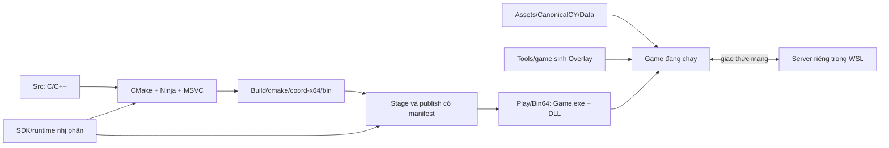

# CY-Source: cấu trúc dự án, nguồn gốc EXE/DLL và kiểm tra hook/inject

**Ngày kiểm tra:** 24/09/2026. **Workspace:** `C:\TLBB\085\CY-Source`.

**Bản chạy được kiểm tra:** `Build/world-gui/stage-play-21/Play.cmd`, thư mục nhị phân `Bin64`.
**Cây build đối chiếu:** `Build/cmake/coord-x64`, cấu hình **Release, x64**.
Git HEAD khi khảo sát: `82517c9ae76a87be48baef009a3ab51af35d4d1f`; cây làm việc có thay đổi chưa commit,
vì vậy HEAD riêng lẻ **không** đại diện đầy đủ cho bản Play.

## 1. Kết luận trực tiếp

1. **Không phải 100% mọi DLL trong Play đều được biên dịch từ mã nguồn trong dự án.**
   Có **18 file PE: 1 EXE và 17 DLL**. Trong đó **Game.exe + 12 DLL** có target CMake và mã nguồn;
   **5 DLL** là runtime/SDK nhị phân có sẵn: `cg.dll`, `fmod.dll`, `fmodL.dll`, `d3dx9_43.dll`,
   `D3DCompiler_43.dll`.
2. Các thành phần chính của client — game, render, OGRE, UI, Lua và tìm đường — có đường build
   từ source trong cây này. Đối chiếu bản Play với đầu ra build: **8/13 file trùng SHA256 hoàn toàn**;
   **5/13 file chỉ khác metadata/ngày build đã xác định**, không khác mã máy ở `.text`.
   Cả 18 file đều khớp hash trong manifest Play.
3. **Có mã hook trong dự án.** Hook đếm cấp phát bộ nhớ của `CysPerf` được liên kết vào `Render.dll`,
   nhưng cần bật `CYS_PERF`; DLL proxy D3D9 và hook đếm draw call nằm trong công cụ chẩn đoán riêng.
   Vì vậy không được kết luận “CY-Source hoàn toàn không có hook”.
4. **Không phát hiện cơ chế inject DLL vào tiến trình khác trong đường khởi chạy Play đã khảo sát.**
   Không có DLL proxy `d3d9.dll` trong Bin64 của Play. Lượt chạy quan sát nạp D3D9 từ
   `C:\Windows\System32\d3d9.dll`, không nạp proxy của dự án. `CYS_PERF` không được bật trong lượt này.
5. Đây là kiểm toán source/build graph, PE và một lượt chạy ở giao diện trước đăng nhập.
   **Không phải chứng nhận tái lập build sạch bit-for-bit hoặc kiểm toán toàn bộ bộ nhớ Windows.**
   Các giới hạn cụ thể ở mục 9.

## 2. Bản đồ thư mục hiện tại

| Đường dẫn | Vai trò thực tế | Cách sử dụng |
|---|---|---|
| `Src/` | Mã nguồn client, engine, thư viện và công cụ C/C++ | Sửa logic/native tại đây; CMake đọc từ đây |
| `Src/cmake/` | Cấu hình build chung và từng thành phần | Xác định target, source, link, DLL copy từ SDK |
| `Tools/build/` | Wrapper thiết lập MSVC rồi gọi CMake/Ninja | Điểm bắt đầu build Windows |
| `Tools/game/` | Sinh layout/Lua/DBC overlay, dựng stage, chạy thử, phát hành Play | Sửa generator khi sửa dữ liệu giao diện |
| `Tools/server/` | Script quản trị và áp thay đổi lên server riêng WSL | Cấu hình, gameplay, dữ liệu thử và kiểm tra Lua |
| `Tools/reapply/` | Các bản sửa dữ liệu có thể áp lại, kèm manifest | Khôi phục thay đổi sau khi dựng lại nguồn dữ liệu |
| `Tools/audit/` | Công cụ kiểm kê PE/build và chụp danh sách module cho tài liệu này | Đọc/ghi bằng chứng kiểm toán; không patch DLL |
| `Assets/CanonicalCY/Data/` | Kho tài nguyên game hiện được Play sử dụng | Model, texture, scene, âm thanh, Lua, layout, bảng dữ liệu |
| `Assets/Sources/`, `Assets/Staging/` | Mô tả nguồn và dữ liệu trung gian | Phục vụ nhập/đối chiếu tài nguyên |
| `Reference/` | Mã và bản phát hành dùng làm tham khảo | Chỉ đọc; không phải thư mục build đang chạy |
| `Registry/` | Giao thức, ABI, đợt nhập, lựa chọn dữ liệu, danh mục API Lua | Dữ liệu có cấu trúc cho generator và kiểm chứng |
| `Tests/` | Kiểm giao thức, scene, font, Lua API, effect và các kiểm tra khác | Không đồng nghĩa mọi target test đều được chạy ở mỗi lần build |
| `Build/cmake/coord-x64/` | CMake cache, Ninja graph, `.obj`, `.lib`, EXE/DLL/PDB | `bin/` là đầu ra build; không tự động là bản Play |
| `Build/world-gui/stage-play-21/` | Bản người dùng mở bằng Play | Chứa Bin64, Patch, Overlay, Data junction và launcher |
| `Build/world-gui/stage-*/` | Các bản ứng viên/kiểm thử khác | Có thể khác source/build/overlay so với Play |
| `Build/Logs/`, `Build/backups/` | Log, ảnh thử, kết quả kiểm chứng và sao lưu | Không lấy một log cũ làm bằng chứng cho hash mới |
| `Docs/`, `Timeline/` | Đặc tả, hướng dẫn, bằng chứng và lịch sử xử lý | Các tài liệu khởi tạo ngày 12/09 có phần đã lỗi thời |
| `.local/` | Cấu hình và thông tin cục bộ, có thể chứa bí mật | Không đưa nội dung tài khoản/mật khẩu vào báo cáo hoặc commit |

### 2.1. Cấu trúc source

```text
Src/
├── CMakeLists.txt
├── cmake/
│   ├── CYSCommon.cmake
│   └── components/*.cmake
├── Client/
│   ├── WXClient/             Game.exe: vòng lặp, nhân vật, input, gameplay, mạng
│   ├── LuaApiGen/            Cầu nối native cho API Lua của giao diện
│   ├── NetCore/              Kết nối/phiên mạng hiện đại
│   ├── WXNetPackets/         Gói tin và xử lý tương thích
│   ├── CEGUISystem/          UI_CEGUI.dll
│   ├── CEGUIFalagardEx/      Widget TLBB, liên kết vào CEGUIFalagard.dll
│   └── Support/              Công cụ/phần hỗ trợ lịch sử; không phải tất cả đều được stage
├── Engine/
│   ├── Interface/           Giao diện tXxxSystem và các bridge giữa module
│   ├── WXEngine/            Kernel/registry/hệ thống nền, build static WXEngine.lib
│   ├── WXCore/              Scene, actor, effect, tài nguyên, perf; static WXCore.lib
│   ├── WXRender/            Render.dll
│   ├── OGRE/                OgreMain + backend Direct3D9 + plugin Cg
│   ├── ParticleFX2/         Plugin_ParticleFX2.dll
│   ├── Scorpio/             Plugin_Scorpio.dll
│   └── PathLib/             PathLib.dll
├── Shared/Common/           Kiểu dữ liệu/header dùng chung của client nguồn
├── ThirdParty/              CEGUI, LuaPlus, FreeType, zlib, DevIL, SDK, ...
└── Tools/                   Viewer, công cụ kiểm render/UI/mạng, D3D9Trace, ...
```

`LuaApiGen` là mã C++ biên dịch vào Game.exe. Các API giả lập/chưa nối đầy đủ ở đây là vấn đề
mức độ hoàn thiện chức năng, không tự động có nghĩa là inject DLL. `Shared/Common` cũng không có nghĩa
server Skynet được biên dịch chung với Game.exe bằng CMake.

### 2.2. Từ source tới bản chạy



- `Play.cmd` xóa các biến môi trường `CYS_*`, rồi gọi `Bin64/Run-CY-Server.cmd`.
  Launcher chạy `Game.exe -fl`; không gọi injector.
- Game nạp `Render.dll` và `UI_CEGUI.dll` bằng cơ chế plugin `tKernel::LoadPlugin`/`DllInit`.
  Đây là cơ chế plugin của chính ứng dụng. Xem `GameProcedure.cpp:635` và `TDKernel.cpp:155`.
- `WXEngine` và `WXCore` là thư viện **static** trong cấu hình này. Không cần có `tEngine.dll` hoặc
  `WXCore.dll` riêng trong Bin64 để coi chúng là đã build.
- `Data` của Play là junction tới `Assets/CanonicalCY/Data`. `WXResources.cfg` còn nạp
  `Overlay/Pre` và `Overlay/Post` để áp các bản chỉnh theo cách tra tên/path của hệ tài nguyên.
- Layout XML, Lua, DBC, mesh, texture, âm thanh và scene là dữ liệu/runtime script. Chúng được
  sao chép hoặc sinh bởi công cụ, không phải toàn bộ đều qua trình biên dịch C++.

## 3. EXE/DLL có target build từ source

Các component dưới đây nằm tại `Src/cmake/components/`. Cột đối chiếu là với
`Build/cmake/coord-x64/bin`, không chỉ dựa vào chữ `kind: build` trong manifest.

| File trong Play | Target CMake | Component/source chính | Đối chiếu |
|---|---|---|---|
| `Game.exe` | `cys_wxclient` | `wxclient.cmake`; WXClient, LuaApiGen, NetCore/codec liên kết static | Trùng SHA256 |
| `Render.dll` | `cys_wxrender` | `wxrender.cmake`; WXRender + WXCore + WXEngine | Trùng SHA256 |
| `OgreMain.dll` | `OgreMain` | `ogremain.cmake`; OGRE + thư viện static | Khác metadata và hai chuỗi ngày DevIL/ILU |
| `RenderSystem_Direct3D9.dll` | `RenderSystem_Direct3D9` | `ogre_d3d9.cmake`; OGRE RenderSystems/Direct3D9 | Trùng SHA256 |
| `Plugin_CgProgramManager.dll` | `Plugin_CgProgramManager` | `ogre_plugins.cmake`; source plugin OGRE | Trùng SHA256; còn phụ thuộc cg.dll có sẵn |
| `Plugin_ParticleFX2.dll` | `cys_particlefx2` | `particlefx2.cmake`; Engine/ParticleFX2 | Trùng SHA256 |
| `Plugin_Scorpio.dll` | `cys_scorpio` | `scorpio.cmake`; Engine/Scorpio | Trùng SHA256 |
| `CEGUIBase.dll` | `cys_ceguibase` | `cegui.cmake`; ThirdParty/CEGUI-0.4.1 | Chỉ khác metadata build |
| `CEGUIFalagard.dll` | `cys_ceguifalagard` | `cegui.cmake` + `falagardex.cmake`; CEGUI và widget TLBB | Trùng SHA256 |
| `CEGUIOgreRenderer.dll` | `cys_ceguiogrerenderer` | `cegui.cmake`; renderer CEGUI/OGRE | Chỉ khác metadata build |
| `UI_CEGUI.dll` | `cys_uisystem` | `uisystem.cmake`; Client/CEGUISystem | Trùng SHA256 |
| `LuaPlus.dll` | `cys_luaplus` | `luaplus.cmake`; ThirdParty/LuaPlus | Chỉ khác metadata build |
| `PathLib.dll` | `cys_pathlib` | `pathlib.cmake`; Engine/PathLib | Chỉ khác metadata build |

### 3.1. Vì sao có năm file không trùng hash?

Các file này trong Play giữ kết quả link từ ngày 20–21/09, còn bản trong cây build được link lại
ngày 23/09. Đã kiểm tra **toàn bộ byte**, với phép so sánh phụ chỉ loại các trường xác định rõ:

- `COFF.TimeDateStamp`, checksum PE, timestamp của export/debug directory;
- GUID và age của bản ghi PDB CodeView, giữ nguyên đường dẫn PDB;
- riêng OgreMain: hai chuỗi `__DATE__` của DevIL và ILU, từ `Sep 20 2026` thành `Sep 23 2026`.
  Nguồn là `Src/ThirdParty/Devil/src-IL/src/il_states.c:23` và `src-ILU/src/ilu_states.c:19`.

Sau khi loại **đúng các trường đó**, cả 13 file có source khớp đầu ra build. Không loại nguyên
section `.rdata`, không bỏ qua mã máy hoặc bảng import để làm cho kết quả khớp. File kiểm toán lưu
các offset/độ dài đã loại. **Không thay DLL trong Play chỉ để làm hash giống một lần link khác.**

Game.exe của bản Play được kiểm tra có SHA256:

```text
b07894047bdc183d74b9e63f9b7066ea108541c432d40d5d03af40c0ad7fcf6f
```

### 3.2. Phụ thuộc static và toolchain

Các thư viện như WXEngine, WXCore, WXNetPackets, NetCore, codec giao thức, FalagardEx, zlib,
zziplib, FreeType, expat, tinyxml, Opcode và DevIL/ILU có target/source và được liên kết vào
EXE/DLL khác. Không xuất hiện dưới dạng DLL riêng là bình thường.

Các module vẫn dùng Windows SDK, MSVC CRT và các import library. Riêng `DxErr9.lib` lấy từ SDK
DirectX có sẵn; `cg.lib` và `d3dx9_43.lib` có thể được tạo từ bảng export của runtime để liên kết.
**Tạo import library không phải biên dịch lại implementation của Cg/DirectX.**

## 4. Năm DLL không được build implementation từ source của dự án

| DLL | Nguồn đã đối chiếu hash | Vai trò | Chữ ký tại thời điểm kiểm tra |
|---|---|---|---|
| `cg.dll` | `C:/TLBB/085/client_GL/Bin64/cg.dll` | NVIDIA Cg 3.1.0013, compiler/runtime shader | Valid — NVIDIA |
| `fmod.dll` | `Src/ThirdParty/_sdk/fmod/api/core/lib/x64/fmod.dll` | FMOD Core 2.02.35, âm thanh | NotSigned; trùng file SDK cục bộ |
| `fmodL.dll` | `Src/ThirdParty/_sdk/fmod/api/core/lib/x64/fmodL.dll` | Biến thể FMOD có logging | NotSigned; trùng file SDK cục bộ |
| `d3dx9_43.dll` | `C:/Windows/System32/d3dx9_43.dll` | Direct3D 9 Extensions, phiên bản 9.29.952.3111 | Valid — Microsoft |
| `D3DCompiler_43.dll` | `C:/Windows/System32/D3DCompiler_43.dll` | Compiler HLSL, phiên bản 9.29.952.3111 | Valid — Microsoft |

Năm file đều trùng SHA256 với bản tham chiếu ghi trên. `NotSigned` chỉ mô tả trạng thái chữ ký,
không tự nó chứng minh file bị sửa hoặc là mã độc.

Trong lượt chạy quan sát, `fmod.dll` được nạp; `fmodL.dll` và `D3DCompiler_43.dll` chưa xuất hiện
trong danh sách module. Có file đi kèm không đồng nghĩa nó đang được dùng ở mọi thời điểm.

**Điểm dễ hiểu sai trong manifest:** `cg.dll` và `fmod.dll` hiện mang `kind: build`, vì công cụ stage
lấy chúng từ thư mục `Build/.../bin`. CMake thực tế **copy DLL có sẵn** vào đó. Nhãn này chỉ phản ánh
nguồn sao chép của stage, không đủ làm bằng chứng “DLL này được biên dịch từ source”.

## 5. Các cơ chế hook đã tìm thấy

### 5.1. Hook IAT đếm cấp phát bộ nhớ trong Render.dll

**Nguồn:** `Src/Engine/WXCore/CYS/Perf/CysPerf.cpp`.

- Lớp `AllocHooks` duyệt bảng import của Game.exe và các module engine/UI đã nạp.
- Thay các entry `malloc`, `realloc`, `calloc`, `free` và một số biến thể CRT bằng thunk đếm
  số lần/số byte rồi chuyển tiếp tới hàm gốc. Đây là **IAT hook thật** trong cùng tiến trình.
- Có `VirtualAlloc` cho vùng mã thunk, `VirtualProtect` khi ghi IAT và `FlushInstructionCache`.
  Vùng thunk có quyền thực thi/ghi ở runtime; điều này không thể suy ra chỉ từ quyền section PE.
- WXCore được liên kết vào Render.dll; PE của Render.dll cũng có các import API tương ứng.
- `WXSystem.cpp:336` gọi `CYS::Perf::install`. Hàm `install` tại `CysPerf.cpp:1444` thoát ngay nếu
  `CYS_PERF` rỗng hoặc bằng `0`. Khi profiler được bật, `CYS_PERF_ALLOC` mặc định là `1`;
  đặt `CYS_PERF_ALLOC=0` sẽ không cài hook cấp phát.
- Code ghi rõ không gỡ patch IAT; các thunk/counter được giữ tới hết tiến trình. Tắt phần hiển thị
  profiler không đồng nghĩa đã gỡ hook của một phiên từng bật nó.

**Trạng thái Play bình thường:** `Play.cmd` xóa mọi biến `CYS_*`, nên cơ chế này không được bật
qua launcher đó. Lượt kiểm tra cũng dùng môi trường đã xóa `CYS_*` và không có dòng cài profiler
trong log. Nếu chạy trực tiếp Game.exe hoặc `Run-CY-Server.cmd` với môi trường khác, phải xét lại;
không lấy kết luận của Play.cmd áp cho mọi cách khởi động.

### 5.2. DLL proxy D3D9 của công cụ đo render

**Nguồn:** `Src/Tools/CysD3D9Trace/D3D9Trace.cpp`.
**Build:** `Src/cmake/components/d3d9trace.cmake`, target `CysD3D9Trace`.
**Đầu ra:** `Build/cmake/coord-x64/bin/d3d9trace/d3d9.dll`.

- DLL export `Direct3DCreate9`, `Direct3DCreate9Ex`, các hàm D3DPERF và chuyển tiếp tới D3D9 thật
  từ System32.
- Khi được đặt cạnh EXE ở một bản chạy thử, DLL proxy sửa vtable của interface D3D9 để ghi draw,
  Present, shader, texture và render target. Đây là **proxy DLL + vtable hook**, không phải chỉ callback.
- Không cần `CreateRemoteThread` để hoạt động: nó được nạp qua cơ chế tìm DLL khi khởi động
  ứng dụng. Vì vậy chỉ tìm API remote injection sẽ bỏ sót loại hook này.
- Đầu ra nằm trong thư mục con riêng. **Không có file này trong Bin64 của Play được kiểm tra.**

### 5.3. Hook draw call trong TlbbViewer

**Nguồn:** `Src/Tools/TlbbViewer/ViewerFx.cpp:381`, `installDrawCounter`.

Chế độ tạo bảng hình effect (`fx-sheet`, lời gọi tại dòng 1422) sửa bốn entry vtable D3D9 để đếm
draw call. Đây là mã công cụ viewer; `TlbbViewer.exe` không nằm trong Bin64 của Play và không
được launcher Play khởi động.

### 5.4. Những tên “hook/inject” không phải DLL injection

- `InjectInput`, `injectMouse*`, `CysInjectKey`: đẩy sự kiện phím/chuột vào hệ input/UI của ứng dụng,
  gồm công cụ kiểm thử được biên dịch vào client.
- `OnUIHook`, `CysUiMeshBridge`: gắn đối tượng 3D vào khung giao diện bằng hàm/bridge của chương trình.
- Render-queue listener và callback: điểm mở rộng engine được gọi trong luồng render.
- `SetWindowLongPtr(..., GWLP_USERDATA/GWL_STYLE, ...)`: lưu dữ liệu cửa sổ hoặc đổi style tại
  các vị trí đã tìm thấy; không phải bằng chứng có hook bàn phím toàn hệ thống.
- `LoadLibrary`/`GetProcAddress` để nạp plugin Render/UI, Cg, hoặc DbgHelp phục vụ crash dump:
  phải xét điểm gọi và DLL đích, không thể coi mọi lần LoadLibrary là inject.

## 6. Kiểm tra PE và lượt chạy thực tế

### Kiểm tra tĩnh

- Kiểm kê đủ 18 file `.exe/.dll` trực tiếp trong Bin64; đều là PE x64 (`Machine=0x8664`).
- Đọc bảng import thường và delay-import, bảng export, section, PDB và SHA256 bằng `pefile`.
- Không có section PE vừa writable vừa executable trong 18 file. Điều này **không phủ định**
  vùng mã runtime của profiler đã mô tả ở trên.
- Không tìm thấy các import remote-injection đã quét: `CreateRemoteThread`, `NtCreateThreadEx`,
  `WriteProcessMemory`, `VirtualAllocEx`, `QueueUserAPC`, `SetWindowsHookExA/W`, v.v.
- Quét source C/C++ và công cụ dự án, theo các API trên cùng Detours/MinHook; không thấy injector
  dùng những cơ chế đó. Các lần `VirtualProtect` có ý nghĩa được lần tới ba cơ chế trong mục 5.

### Kiểm tra động

- Khởi chạy chính Game.exe của Play với `-fl`, xóa `CYS_*` như launcher Play, **không đăng nhập tài khoản**.
- Ghi 12 lần chụp danh sách module trong khoảng 60 giây; ảnh chụp cuối có **87 module**.
- Các module được quan sát chỉ nằm trong Bin64 của Play hoặc cây Windows/System32/DriverStore.
  Có DLL driver NVIDIA và runtime Windows, không có module từ thư mục proxy chẩn đoán.
- `d3d9.dll` thực sự nạp từ `C:\Windows\SYSTEM32\d3d9.dll`.
- Không có `fmodL.dll`, proxy `d3d9.dll` của dự án hoặc module lạ ngoài hai nhóm đường dẫn trên
  trong lượt quan sát. Không thấy log cài CYS-PERF.
- Chỉ đóng PID do công cụ kiểm toán mở; không đụng phiên người chơi. File WXSystem.cfg được
  trả lại đúng bytes trước lượt đo.

## 7. Server WSL nằm ở đâu, có build chung không?

Bản Play này dùng server riêng **`/home/ubuntu/cys-test-20260913`**, hồ sơ `cys-server`,
login/game ở `127.0.0.1:15733/15734`.

| Đường dẫn dưới server riêng | Nội dung |
|---|---|
| `GameServer/services/`, `GameServer/lualib/` | Logic dịch vụ, mạng, nhân vật và module Lua |
| `Game_2/Script/` | NPC, nhiệm vụ, sự kiện và gameplay Lua |
| `Game_2/Scene/` | Scene và bố trí NPC/quái |
| `configs/` | Bảng dữ liệu gameplay |
| `confs/publish_yu/` | Cấu hình runtime |
| `GameServer/framework/` | Skynet, Makefile, `skynet-src`, source Lua/C hỗ trợ và ELF đã build |
| `GameServer/lualib-src/`, `service-src/` | Source module native của server |
| `GameServer/luaclib/`, `cservice/` | Module native đã build |

Đã thấy source C/C++ và Makefile của framework. `Game_tlbb_2`, `Manager_tlbb_8`,
`DataCenter_tlbb_9`, `Tool_tlbb_6` hiện trùng SHA256 với `framework/skynet`; tên chương trình
khác nhau không có nghĩa bốn engine được viết/build riêng.

**Server không được build bởi `Src/CMakeLists.txt` của client.** Đợt này không rebuild Skynet,
không kiểm toán provenance từng `.so`, MongoDB, MQTT hoặc thư viện Linux. Vì vậy không suy rộng
kết luận “13 module client có source” thành “toàn bộ client và server đều được tự build 100%”.

## 8. Build, stage và cách kiểm tra lại

Toolchain hiện dùng: Visual Studio 2022 Build Tools, MSVC `14.44.35207`, CMake/Ninja đi kèm,
x64 Release. `CYSCommon.cmake` cấu hình C++14, CRT động và symbol PDB.

Ví dụ build riêng Game.exe bằng wrapper hiện có:

```bat
Tools\build\build.cmd x64 coord-x64 Release "" cys_wxclient
```

**Lưu ý:** Game.exe nạp Render/UI ở runtime nên build riêng target Game không bảo đảm đã build lại
mọi DLL render/UI. Muốn dựng toàn cây trong thư mục build riêng:

```bat
Tools\build\build.cmd x64 audit-clean Release
```

Lệnh thứ hai là hướng dẫn, **chưa chạy trong đợt kiểm toán này**. Nó có thể build cả viewer, test
và DLL chẩn đoán, nhưng không tự chép mọi thứ sang Play. Không copy đệ quy cả thư mục build/bin
vào Play, vì có đầu ra công cụ chẩn đoán và file không dùng khi chơi.

Kiểm kê lại PE và đối chiếu build (không nạp DLL):

```powershell
& 'C:/Program Files/Python313/python.exe' -X utf8 `
  Tools/audit/audit_client_binaries.py `
  --out Build/Logs/2026-09-24-source-audit
```

Chụp module bằng một phiên trước đăng nhập, từ chối nếu đã có Game.exe:

```powershell
./Tools/audit/capture_client_modules.ps1
```

`ninja -n` đã được thử trong đợt khảo sát; nó chỉ báo kiểm tra glob và cần chạy lại CMake.
Không dùng kết quả đó để khẳng định “clean build đã thành công” hoặc “mọi file đều up-to-date”.

## 9. Giới hạn và những việc nên tách riêng

- Không vừa xóa sạch rồi biên dịch lại toàn bộ cây source trong đợt này. Kết luận provenance dựa
  trên target/source/link graph, PE, manifest, file SDK, hash đầu ra và phân tích khác biệt bytes.
- Quan sát động chỉ ở màn hình trước đăng nhập; không khẳng định mọi DLL có thể nạp muộn trong
  mọi map/chức năng đều đã xuất hiện.
- Liệt kê module không phát hiện được mọi dạng mã nạp thủ công/ẩn trong bộ nhớ; quét import cũng
  không loại trừ hoàn toàn API được resolve động. DLL SDK đóng không được dịch ngược toàn bộ.
- Không thấy injector trong đường Play đã khảo sát; không đưa ra chứng nhận “mọi phần mềm trên
  máy không thể inject vào game”.
- Nên làm rõ nhãn provenance của manifest: **compiled from source / copied SDK / system runtime**.
  Nhãn `kind: build` hiện chưa phân biệt được các loại đó.
- Nếu yêu cầu bản phát hành tuyệt đối không chứa code hook, cần một thay đổi build riêng để loại
  `AllocHooks` khỏi Render.dll và tách công cụ chẩn đoán. Xóa DLL proxy khỏi Play thôi chưa loại bỏ
  source hook của profiler vốn đã liên kết vào Render.dll. Đợt kiểm toán này chưa thực hiện thay đổi đó.

## 10. Bằng chứng và tệp liên quan

- [Kết quả kiểm toán rút gọn, có SHA256](evidence/source-audit-20260924.json).
- `Build/Logs/2026-09-24-source-audit/binary-inventory.json`: đầy đủ PE/import/section, nguồn và đối chiếu.
- `Build/Logs/2026-09-24-source-audit/build-source-edges.txt`: các cạnh biên dịch object trong Ninja.
- `Build/Logs/2026-09-24-source-audit/vendor-signatures.json`: phiên bản và chữ ký runtime.
- `Build/Logs/2026-09-24-source-audit/runtime/modules.json`: PID, thời điểm và đường dẫn module thực tế.
- `Build/Logs/2026-09-24-source-audit/diagnostic-proxy.json`: export/import của DLL proxy riêng.
- `Build/Logs/2026-09-24-source-audit/server-native-scope.txt`: phạm vi source/framework server đã khảo sát.
- [Công cụ kiểm kê PE](../Tools/audit/audit_client_binaries.py).
- [Công cụ chụp module](../Tools/audit/capture_client_modules.ps1).

Đợt này chỉ tạo công cụ/bằng chứng kiểm toán và tài liệu; không sửa logic game, không phát hành DLL
mới và không thay đổi dữ liệu nhân vật hoặc cấu hình server.
