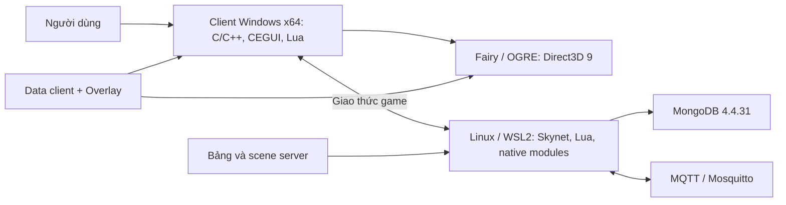

# Kiến trúc 372dragon

[← Tài liệu](README.md) · [Bản đồ repository →](repository-map.md)

Client Windows x64 kết nối server Skynet/Lua riêng. Data client và bảng/scene server
được chia sẻ ngoài Git.

## Client

`Src/Client` chứa ứng dụng, gameplay, UI và packet handler phía client.
`Src/Engine` chứa Fairy/OGRE và module engine. Nhánh công bố này dùng Direct3D 9;
không suy từ dự án GL riêng rằng nó đã dùng Direct3D 11. `Src/Shared` chứa common/protocol.

CEGUI/Lua xử lý layout, sự kiện và nội dung giao diện. UI hiện ra không tự chứng
minh thao tác phía server đã có backend. CMake tạo executable/DLL; staging chọn
output, runtime, config và data để thành bản chạy. Game nạp module động, nên build
một target không đảm bảo mọi DLL trong Play đều mới.

## Server

`Server/GameServer/framework` là nền Skynet/Lua/native. Logic game và module riêng
ở `Server/GameServer`; script ở `Server/Game_2/Script`, với bảng/scene từ data.
Giao dịch item, tiền, GUID và lưu nhân vật phải kiểm ở server, kể cả sau thoát sạch
và đăng nhập lại. Hiển thị client đúng chưa chứng minh lưu trạng thái đúng.

## Hợp đồng giữa code và data

| Hợp đồng | Khi sửa phải giữ gì? |
|---|---|
| Packet | ID, kiểu trường, thứ tự, độ dài và handler hai phía |
| Tài nguyên | Tên file, material/skeleton/animation và encoding khóa |
| Bảng | Schema, ID, thứ tự và ánh xạ client/server |
| Runtime | x64, phiên bản DLL, cấu hình plugin, hash bản đang chạy |
| Persistence | Giá trị trước/sau thao tác và sau lần đăng nhập tiếp |

ID giống nhau ở CY, GL, HJ và 0.85 không mặc nhiên là cùng nội dung. Một số `all.*`
và tên bên trong model dùng GBK; sửa phải giữ round-trip byte, nguồn và cách khôi phục.

## Ranh giới phân phối

Source/công cụ/tài liệu ở repository. Data có manifest riêng. SDK/runtime lấy theo
điều khoản nhà cung cấp. Database, bí mật, trạng thái máy cài, cache build và Git
history riêng không thuộc gói công bố.

[Kiểm toán cấu trúc 24/09/2026](../10-CAU-TRUC-VA-KIEM-TOAN-BUILD_vi.md) ghi target
và bằng chứng thời điểm đó; không thay nghiệm thu toàn bộ bản xuất 15/10/2026.
