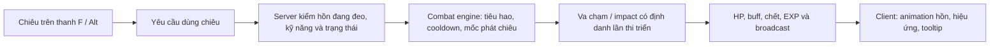

# Võ hồn và Chiến hồn — khảo sát hiện trạng và thiết kế đề xuất

Ngày: 25/09/2026. Đây là bản khảo sát v0.1 được lập trước triển khai. Sau yêu cầu **“làm đi”**, prototype pháp bảo do người chơi dùng chiêu, giữ riêng dữ liệu cũ đã được thực hiện; trạng thái và bằng chứng nằm tại [hồ sơ triển khai](dual-souls-implementation-20260925_vi.md). Các phần nâng cấp trả phí, lắp chiêu tự do và cân bằng bên dưới vẫn là đề xuất.

Phạm vi khảo sát: CY-Source, bản Play21 và server riêng `/home/ubuntu/cys-test-20260913`. Chỉ đọc source/bảng dữ liệu, không sửa nhân vật, không đổi server, không build hoặc phát hành game trong lượt phân tích này.

## 1. Yêu cầu đã có và các giả định

Người dùng muốn tự thiết kế lại hai hệ hoạt động song song:

- **Võ hồn:** buff, bị động, phòng thủ.
- **Chiến hồn:** kỹ năng chủ động, gây sát thương và hiệu ứng.
- Hai hồn xuất hiện đồng thời ở hai bên nhân vật.

Quy ước đề xuất: Võ hồn bên phải, Chiến hồn bên trái **theo hướng của nhân vật**, không theo màn hình. Khi nhìn chính diện, hai bên trên màn hình sẽ đảo. Vị trí cụ thể chưa được người dùng chốt.

Ba lựa chọn đã gửi để làm rõ, chưa có câu trả lời tại thời điểm lập bản này:

1. Chiến hồn là pháp bảo được người chơi điều khiển hay linh thể có tự đánh?
2. Kỹ năng theo bản sắc từng loại hồn, lắp tự do, hay kết hợp?
3. Giữ tiến độ Võ hồn cũ để chuyển đổi hay thử hệ mới độc lập trước?

Bản đề xuất dưới đây tạm lấy hướng **pháp bảo do người chơi dùng chiêu**, **có chiêu đặc trưng và ô tùy biến**, **giữ dữ liệu cũ để lập phương án chuyển đổi**. Đây là đề xuất, không phải quyết định đã được duyệt. Cấp tối đa, phí, tỷ lệ, thời gian hồi và hệ số sát thương chưa chốt.

## 2. Những gì source hiện tại thực sự có

### Trang bị, thuộc tính và lưu dữ liệu

- Võ hồn dùng một slot `HEQUIP_WUHUN = 18` ở server/C++; host Lua trang bị có quy ước chỉ số khác ở một số chỗ. Không dùng lẫn số ô UI, equip point và chỉ số túi.
- Instance hiện có cấp, EXP, trưởng thành, thọ, hợp thành, ba kỹ năng và mảng thuộc tính mở rộng. Kỹ năng được cấp khi đeo, còn thọ và đạt mốc 40/70/90.
- Hợp thành hiện tối đa 7; các chuỗi kỹ năng hiện có sáu cấp. Đây là giới hạn hệ cũ, không mặc định áp cho thiết kế mới.
- `human_attrib::kfs_effect_flush` cộng thuộc tính cơ bản, mở rộng và Huyễn hồn. Hệ hiện có cả thuộc tính công lẫn thủ, chưa phân vai như yêu cầu mới.
- Dữ liệu Võ hồn vật phẩm nằm trong trang bị; tiến độ Huyễn hồn nằm ở `huanhun` của nhân vật. Bộ lưu nhân vật serialize cả hai. Cần bảo toàn cả hai khi chuyển đổi.
- Huyễn hồn đã mở có thuộc tính nền; hồn gắn Càn hoặc Khôn đổi bộ thuộc tính tương ứng. Việc chỉ hiển thị một hình không có nghĩa chỉ một nguồn thuộc tính được cộng. Không thể đổi tên Càn/Khôn rồi cộng thêm hai hệ mới mà bỏ qua phép tính cũ.

### Kỹ năng hiện có

Audit đọc bảng client đang dùng và bảng server thật, đối chiếu template/passive flag và chuỗi nâng cấp:

| Nhóm cũ | Dòng kỹ năng | Cấp mỗi dòng | Phân loại từ bảng |
|---|---:|---:|---|
| Ô lĩnh ngộ thứ nhất | 9 | 6 | Bị động |
| Ô lĩnh ngộ thứ hai | 26 | 6 | Chủ động; buff/debuff cần phân theo hiệu quả |
| Ô lĩnh ngộ thứ ba | 14 | 6 | Chủ động; nhóm tấn công cũ |
| Tổng | **49** | | **294 bản ghi cấp**, 9 dòng bị động và 40 dòng chủ động |

Ví dụ tên thực có: Thanh Dật Chi Hồn, Ngự Thể Chi Hồn, Ngưng Lực Chi Hồn, Cương Mãnh Trọng Kích, Hàn Băng Xuyên Thứ, Thiên Lôi Oanh Đỉnh. Tên hoặc icon không chứng minh chính xác hiệu quả; khi tái sử dụng phải lần tiếp SkillTemplate → SkillData → impact/logic.

`cy_equipment_skills` dùng pool CY đã đối chiếu, kiểm GUID/snapshot khi tẩy và nhận kỹ năng. Không dùng nguyên `define.WUHUN_SKILLS` cũ của GL: trong đó còn ID không tương đương CY.

`get_total_skills_list` lấy chiêu Võ hồn từ trang bị, tham gia danh sách kỹ năng của nhân vật. `skillenginer::process_skill_request` kiểm quyền học khi template bật `use_need_learnd`, cùng trạng thái, cooldown và điều kiện sử dụng. Đây là đường nên nối kỹ năng Chiến hồn vào, với kiểm quyền sở hữu hồn rõ ràng, không chỉ hiện thêm icon.

Audit này xác nhận cấu trúc và mapping. **Không phải kiểm chiến đấu trực tiếp đủ 49 dòng kỹ năng.**

### Huyễn hóa và mô hình

- Một `KFSObj` được gắn lên actor. `GCCharEquipment` hiện gửi một cặp item/visual Võ hồn. `CysWuhunNet::PreviewModel` chọn một dạng Càn/Khôn để hiển thị.
- Càn/Khôn hiện là hai lựa chọn trong cùng hệ Huyễn hồn; không có hai vật phẩm Võ hồn/Chiến hồn độc lập cùng xuất hiện.
- Đường hiện có đã nối world, SelfEquip và màn chọn nhân vật. Tab VH dựng riêng model Võ hồn, tránh lỗi dựng lại cả nhân vật.
- Có sẵn hai nhóm model cơ bản và sáu dòng Huyễn hồn, mỗi dòng hai dạng/ba bậc. Có thể dùng làm kho hình cho prototype, phải chọn theo mesh/effect thật.
- Engine xử lý thuộc tính `SlotCreate` qua `changeSlotAttrib`. Có nền để thêm attachment riêng, nhưng cần khai báo locator/slot trên actor và kiểm thực tế; chưa có bằng chứng một tên slot mới tự hoạt động chỉ bằng packet.

## 3. Thiết kế gameplay đề xuất

### Hai vai trò độc lập

| Thành phần | Võ hồn | Chiến hồn |
|---|---|---|
| Mục tiêu | Giúp sống sót, hỗ trợ và ổn định giao tranh | Bổ sung cách tấn công và thời điểm gây áp lực |
| Hiệu quả chính | Khiên, kháng, giảm sát thương, hồi phục, giải hiệu ứng có điều kiện | Đơn mục tiêu, diện rộng, đạn, sát thương theo thời gian, khống chế có giới hạn |
| Điều khiển | Bị động và buff chủ động | Người chơi chủ động chọn chiêu/mục tiêu |
| Bộ ô thử ban đầu | 2 ô bị động + 1 ô buff/phòng thủ chủ động | 1 chiêu đơn mục tiêu + 1 chiêu chiến thuật/diện rộng + 1 tuyệt kỹ |
| Thuộc tính tăng trưởng | HP, phòng thủ, kháng, hiệu quả hỗ trợ | Sức mạnh chiêu hồn, chính xác/thuộc tính công được chọn |
| Ngoại hình | Chuyển động ổn định, hiệu ứng hộ thể dễ đọc | Phản ứng theo lúc tụ lực/phóng chiêu, hiệu ứng thể hiện hướng đánh |

Số ô là cấu hình thử, không khóa cứng vào giới hạn ba ô trong packet cũ. Võ hồn có thể buff sức mạnh cho đồng đội nhưng không kiêm một nguồn sát thương trực tiếp lớn. Các hiệu quả phản đòn gây sát thương phải được phân vai có chủ đích, không lọt vào hệ thủ qua cách đặt tên.

Chiến hồn dùng nhân vật làm chủ thể tính sát thương, PK, aggro, kill credit và EXP. Mô hình hồn là nơi trình diễn/phát hiệu ứng; trước mắt không có HP, va chạm, túi đồ, AI tìm đường riêng như trân thú. Nếu người dùng chọn linh thể tự đánh, cần thiết kế thêm vòng AI, phạm vi chủ nhân, ngắt mục tiêu và ngân sách hiệu năng.

### Bản sắc từng loại và tùy biến

Mỗi loại có một cơ chế đặc trưng; người chơi chọn phần còn lại trong danh sách hợp vai. Ví dụ thiết kế mới, chưa phải chiêu đã tồn tại:

| Loại đề xuất | Đặc trưng | Một kỹ năng chủ động minh họa |
|---|---|---|
| Võ hồn Huyền Giáp | Chống dồn sát thương, khiên có giới hạn | **Hộ Thân Cương Khí:** tạo khiên trong một khoảng thời gian |
| Võ hồn Thanh Liên | Hồi phục, chống hiệu ứng xấu | **Tịnh Tâm:** gỡ một nhóm hiệu ứng cho phép, không giải mọi khống chế |
| Võ hồn Phong Linh | Cơ động, hỗ trợ vị trí | **Linh Phong:** tăng cơ động trong thời gian ngắn, không tạo bất tử |
| Chiến hồn Kiếm Ảnh | Đòn chính xác, đường kiếm có hướng | **Xuyên Tâm Kiếm:** đạn/đường kiếm tới mục tiêu, sát thương tại mốc trúng |
| Chiến hồn Viêm Long | Tạo vùng áp lực | **Viêm Vực:** vùng sát thương có báo trước và thời hạn |
| Chiến hồn Lôi Đình | Đổi mục tiêu, kiểm soát nhịp đánh | **Lôi Liên:** nảy qua số mục tiêu giới hạn, không lặp vô tận một mục tiêu |

Không cho lắp chiêu sát thương vào ô Võ hồn hoặc ba chiêu phòng thủ mạnh vào Chiến hồn. Phân loại bằng dữ liệu server, không chỉ bộ lọc UI.

Các hiệu ứng xuyên tuyến, vùng và nảy mục tiêu chỉ được coi là tái sử dụng khi tìm được logic sẵn có tương ứng; model đẹp hoặc VFX tương tự không đủ bằng chứng. Nếu không có logic phù hợp thì phải viết và kiểm mới.

### Tăng trưởng và phối hợp

- Mỗi hồn có cấp/EXP, phẩm/bậc, kỹ năng và ngoại hình riêng. Việc gắn hai hồn không tự nhân đôi EXP nhận từ một sự kiện.
- Nên rút gọn các trục nâng cấp: cấp hồn tăng nền, bậc mở cơ chế/ô kỹ năng, cấp chiêu tăng hiệu quả. Không mặc định giữ cùng lúc mọi trục trưởng thành, thọ, hợp thành, đột phá, tẩy cũ nếu chúng trùng mục đích.
- Ngoại hình độc lập với bộ chiêu: huyễn hóa đổi hình, không tự đổi loại sát thương hoặc reset cấp.
- Prototype dùng tài nguyên/cooldown sẵn có trước; thanh Hồn lực chung hay riêng là tùy chọn thiết kế tiếp theo, chưa thêm mặc định một thanh tài nguyên mới.
- Có thể thêm **cộng hưởng** ở giai đoạn sau, ví dụ dùng buff đúng lúc cường hóa chiêu Chiến hồn tiếp theo. Cộng hưởng có giới hạn, không bắt buộc người chơi ghép một cặp duy nhất và không để hiệu ứng kích hoạt lẫn nhau vô tận.
- Bộ kỹ năng môn phái vẫn giữ vai trò chính. Tổng sát thương của Chiến hồn và sức phòng thủ của Võ hồn cần đo riêng trong PvE/PvP trước khi chốt hệ số; chưa đặt tỷ lệ phần trăm tùy ý vào game.

## 4. Hình ảnh và giao diện

- Hai ô trang bị riêng, hai mô hình đồng thời, hai nút ẩn/hiện. Ẩn hình chỉ đổi trình bày, không đổi trạng thái đang trang bị hoặc hiệu lực kỹ năng.
- SelfEquip đặt ô hai hồn quanh mô hình nhân vật, cùng skin vàng/nâu đang dùng, nền ô và viền phẩm riêng. Nhãn ghi Võ hồn/Chiến hồn, không gọi cả hai là Càn/Khôn.
- Khung chi tiết chung có tab **Võ hồn / Chiến hồn / Cộng hưởng**; tab Cộng hưởng chỉ thêm khi có chức năng thật. Mỗi tab xem riêng model của hồn được chọn.
- Hai thư viện chiêu riêng trong bảng kỹ năng. Chiêu chủ động kéo được xuống F và Alt+số; chiêu bị động có nhãn rõ, không tạo nút bấm giả.
- Thanh Alt+số giữ nền ô trong suốt theo yêu cầu trước đây. Không ép dùng phím cố định mới khi người chơi đã có hệ phím tắt.
- Tooltip ghi rõ loại hồn, chiêu đang có, điều kiện trang bị, phí, cooldown, cấp hiện tại và mức kế tiếp từ cùng công thức server. Hiển thị nguồn cộng thuộc tính để tránh nhầm cộng hai lần.
- World, SelfEquip, màn chọn nhân vật và kiểm tra người khác đều phải có đủ hai hồn và trạng thái ẩn/hiện tương ứng.
- Hai locator theo hướng nhân vật; không chỉ nhân scale âm để lật model vì có thể đảo mặt/hiệu ứng. Chỉnh offset, góc và tỷ lệ theo giới tính, cưỡi, biến thân và từng nhóm model.
- Hiệu ứng thường trực tiết chế, tuyệt kỹ có điểm nhấn ngắn. Đo tải cảnh đông người, chia chất lượng hiển thị người gần/xa; thay LOD hình không thay kết quả combat.

## 5. Cách triển khai trên nền hiện có

### Mô hình dữ liệu

Giữ cùng một bộ xử lý chung cho hồn, nhưng hai vai và hai instance độc lập:

```text
SoulInstance: GUID, role, template, level, exp, grade,
              skill_slots, appearance, revision, schema_version
SoulLoadout:  support_guid, assault_guid, visibility, revision
SoulCatalog:  role, allowed_skill_tags, progression, visual_map
```

Đây là cấu trúc đề xuất. Phải định nghĩa cách serialize vào item/DB và quyền sở hữu, không dùng object minh họa này làm schema sản xuất ngay.

- Võ hồn cũ giữ GUID và tiến độ qua lớp đọc tương thích. Chiến hồn có slot/item identity riêng; cùng một GUID không được nằm trong cả hai ô.
- Không lấy slot 19: đang là Linh vũ/Long văn ở tuyến hiện tại. Dải còn trống chỉ được chốt sau khi kiểm enum, container, packet mask, tooltip, equip constraints và dữ liệu lưu.
- Skill ID, visual ID, item ID và effect ID cấp riêng qua registry. Không đổi ý nghĩa một ID cũ trong khi nhân vật vẫn đang lưu nó.
- Chi phí nâng/lắp/tẩy được xác thực và commit trong actor sở hữu nhân vật. Kiểm GUID/revision, khóa, túi đầy, nguyên liệu và phản hồi lặp như tuyến đã có.

### Nối combat và đồng bộ



- Kỹ năng mới luôn kiểm đúng vai hồn, GUID đang đeo và kỹ năng đã mở trên server; không phụ thuộc riêng cờ `use_need_learnd` hay UI.
- Dùng combat engine hiện có để hưởng quy tắc mục tiêu, scene, PK, miễn nhiễm, cooldown và log. Không gọi trừ HP trực tiếp từ Lua giao diện.
- Đạn của Chiến hồn phải có mốc phóng/chạm; không cộng EXP trước khi sát thương làm mục tiêu chết. Xác thực mục tiêu còn cùng instance/scene khi callback chạy.
- Bản đầu đi qua cùng hàng đợi hành động của nhân vật. Không để hồn tự mở đường thi triển chồng lên khinh công, choáng, chuyển cảnh hoặc động tác chưa được phép ngắt. Nếu muốn cast song song cần luật riêng được thiết kế và đo.
- Không reset cooldown bằng tháo/gắn, đổi skin, đổi hồn hoặc relogin. Cooldown cần khóa theo chủ nhân + nhóm chiêu, lưu/khôi phục mốc thời gian theo chính sách đã chốt.
- Buff khi đổi/tháo hồn và đạn đã phóng phải có chính sách rõ. Đề xuất chặn đổi hồn trong giao tranh; effect đang bay giữ snapshot cast đã được server chấp nhận, hủy khi sai scene/mục tiêu. Không tạo thêm vòng tấn công khi mục tiêu đã chết.
- Bị động kích hoạt theo sự kiện cần hồi nội bộ, giới hạn số lần và nguồn kích hoạt; damage do proc không mặc nhiên kích lại chính proc đó.
- Bổ sung state riêng có version/revision cho hai hồn. `GCCharEquipment` hiện có một cặp Võ hồn nên không nhét Chiến hồn vào trường Càn/Khôn cũ. Cần cập nhật protocol registry, decoder/encoder, login và AOI spawn/update đồng bộ; chọn packet/mask sau kiểm ABI.
- Actor thêm attachment riêng như `BattleSoulObj`, cùng `KFSObj` hiện có hoặc hai tên mới qua lớp tương thích. Giữ slot vũ khí, bối sức và PETObj đang có.

### Chuyển đổi dữ liệu cũ

Nếu chọn giữ tiến độ: lập bảng quy đổi cấp/EXP, kỹ năng, sách/nguyên liệu và Huyễn hồn trước. Chỉ chạy chuyển đổi một lần bằng `schema_version`, có backup và báo cáo trước/sau. Phân loại chiêu hỗ trợ/phòng thủ sang Võ hồn, chiêu tấn công sang Chiến hồn hoặc quyền lựa chọn/bồi hoàn theo quyết định người dùng; **chưa tự chọn cách chia tài sản**.

Tại thời điểm chuyển, nhân vật chỉ nhận thuộc tính từ một bộ luật tương ứng phiên bản dữ liệu. Không vừa cộng `kfs_effect_flush` cũ vừa cộng hệ mới. Khả năng hoàn tác phải giữ dữ liệu nguồn; không xóa tiến độ cũ để tạo cảm giác hệ mới sạch.

## 6. Thứ tự thực hiện đề xuất

1. Chốt pháp bảo/linh thể, bản sắc kỹ năng, cách giữ tiến độ và quy ước trái/phải; viết bộ luật nhỏ cho prototype.
2. Dựng hai attachment với model hiện có, trang bị độc lập, ẩn/hiện, SelfEquip/inspect/select-role và lưu–nạp. Chưa thêm nhiều loại/chiêu.
3. Làm lát cắt hoàn chỉnh: **một Võ hồn có một bị động + một buff**, **một Chiến hồn có một đòn đơn mục tiêu + một chiêu diện rộng**; có tooltip, phím tắt, cooldown, cost và kết quả combat thật.
4. Kiểm tháo/gắn, đủ/thiếu phí, gửi lặp, relogin, chuyển cảnh, chết/hồi sinh, đổi mục tiêu giữa lúc đạn bay, PvP và tự chiến đấu. Tài khoản thử phải phục hồi BSON đầy đủ.
5. Đo cân bằng/hiệu năng, rồi mới mở nhiều hệ hồn, nâng cấp, cộng hưởng và chuyển đổi dữ liệu người chơi.

Tiêu chí hoàn tất prototype: hai hình đúng vị trí và không mất thân; hai item tồn tại/lưu độc lập; tháo hồn mất đúng quyền dùng chiêu; F/Alt dùng được; damage/EXP đúng thời điểm; không reset cooldown hay nhân đôi nguyên liệu; chuyển scene/relogin không mất hồn hoặc cộng lặp chỉ số. Ảnh đẹp hoặc mở được khung chưa đủ.

## 7. Bằng chứng và điểm sửa chính

Audit tái chạy: `python Tools/audit/audit_dual_souls.py`. Kết quả: [dual-souls-audit-20260925.json](../evidence/dual-souls-audit-20260925.json), gồm hash Game, manifest Play, nguồn server/client, 49 dòng và 294 ID cấp. Đây là audit đọc tĩnh, không kết nối tài khoản.

| Phần | Nguồn cần dùng |
|---|---|
| Item/skill Võ hồn | server `lualib/item.lua`, `lualib/cy_equipment_skills.lua`, `scripts/event/equip/wuhun.lua` |
| Quyền kỹ năng, lưu nhân vật | server `services/scene/obj/human.lua`; `scenecore.lua` dùng lớp này. Bản `services/scene/human.lua` cùng tên không tự chứng minh là tuyến duy nhất đang chạy |
| Thuộc tính/huyễn hồn | server `lualib/db/human_attrib.lua`, `Tools/server/cys_wuhun_appearance.lua` |
| Cast/impact | server `lualib/skillenginer.lua`, scene skill/impact engine |
| Giao diện Võ hồn/huyễn hóa | `CysHost_EquipmentSkills.cpp`, `CysWuhunNet.cpp`, `Tools/game/power_ui.py`, `wuhun_appearance_ui.py` |
| Nhân vật/preview | `Obj_PlayerOther.cpp::UpdateWuhun`, `CysCreateRoleGame.cpp`, `CysHost_MeshWin.cpp`, CharacterData |
| Attachment engine | `WXLogicModel.cpp::setAttribute`, `SlotCreate` → `changeSlotAttrib`; actor .obj nam/nữ/world/preview |
| Phím tắt | `CysSkillNet.cpp`, `CysQuickbarContract.h`, GMActionSystem |
| Protocol | `Registry/protocol/packets.yaml`, generated packet code và server packet_types; không sửa generated output riêng lẻ |

Không triển khai gameplay hoặc chuyển đổi tài sản trong lượt phân tích này. Các tên hồn/chiêu, số ô và lộ trình là đề xuất để phát triển hệ riêng theo ý người dùng, không gán chúng cho CY/GL chính thức.
